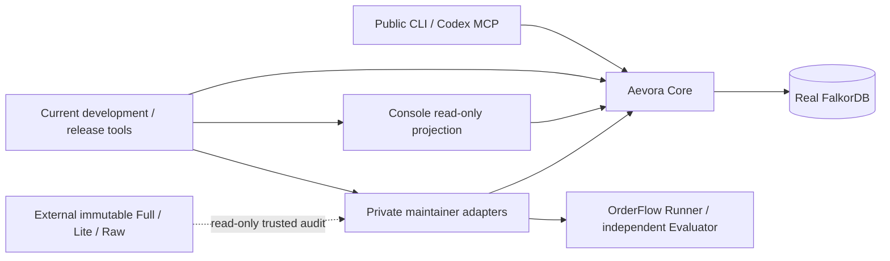

# Gen 1.5 target architecture (G1 frozen before code)

The stable package roots remain `aevora_core/` and `console/`. OrderFlow remains a private independent Benchmark. This consolidation does not change IDs, WHEN/WHY, lifecycle transitions, Oracle or model runtime.

## Ownership and concrete changes

The CSV covers all 501 frozen source files with one owner per file; directory classification covers every other inventoried file. Product runtime owns resolver, graph repository, governance, lifecycle and scoped MCP. Console owns reads/UI, not decisions. Public UX owns Hero/Replay/deployment and bootstrap. Private maintainer owns Benchmark/Oracle/isolation/Outcome verification. Validation owns current command/build/supply-chain checks. Historic archives/reports have immutable owner.

1. Move the unchanged host Audit Capsule body into `aevora_maintainer`; preserve legacy import as an explicit optional alias with identical module monkeypatch identity. Public wheel includes only the alias, not the body or private dependency.
2. Make `tools/public_evidence` the sole authoring source of HeroVerifier/disclosure policy. Generate byte-exact H4/Console copies because independent stdlib replay and inherited exact-copy tests require them. Check hashes; do not maintain independent engines.
3. Retain valid phase scripts as scope-bound reproduction adapters. Add one standard-library current command entry and GNU Make aliases. Reuse existing CLI/build/browser contracts, no scheduler/orchestrator.
4. Publish current guide/index and owner map without rewriting frozen reports/task books. Root historical reports stay byte-exact for inbound links and provenance.
5. Explicit public release allowlist; current source+bounded receipts export excludes private truth and raw model logs. Preserve stable distribution names/entrypoints.

## Rollback and pre-migration checks

Every mapped source must be present and hash-equal before G2. Stage named paths only in the new worktree and commit each slice. Rollback is `git revert <slice>` in this worktree, never reset/clean original root. Core and Console public package installs must work without Benchmark. Optional host verification dependencies stay explicit; OrderFlow outcome bridge uses deferred private parser/admission imports only in the trusted host path.

Git worktree and ordinary Make phony targets are mature tooling: [Git worktree](https://git-scm.com/docs/git-worktree), [GNU Make](https://www.gnu.org/software/make/manual/html_node/Phony-Targets.html). No new task orchestrator or plugin architecture is needed.
