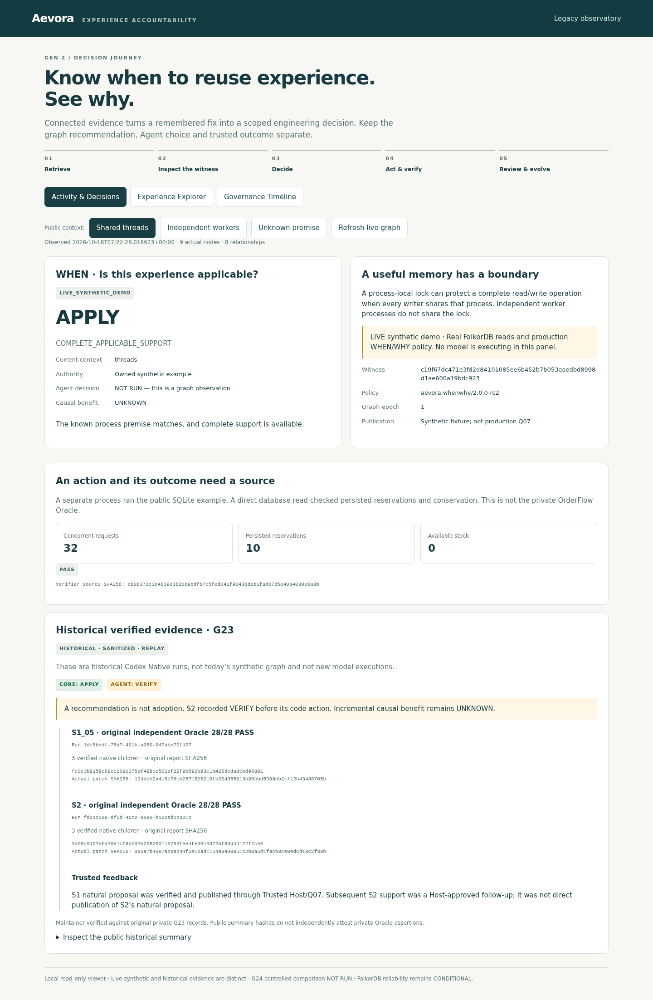
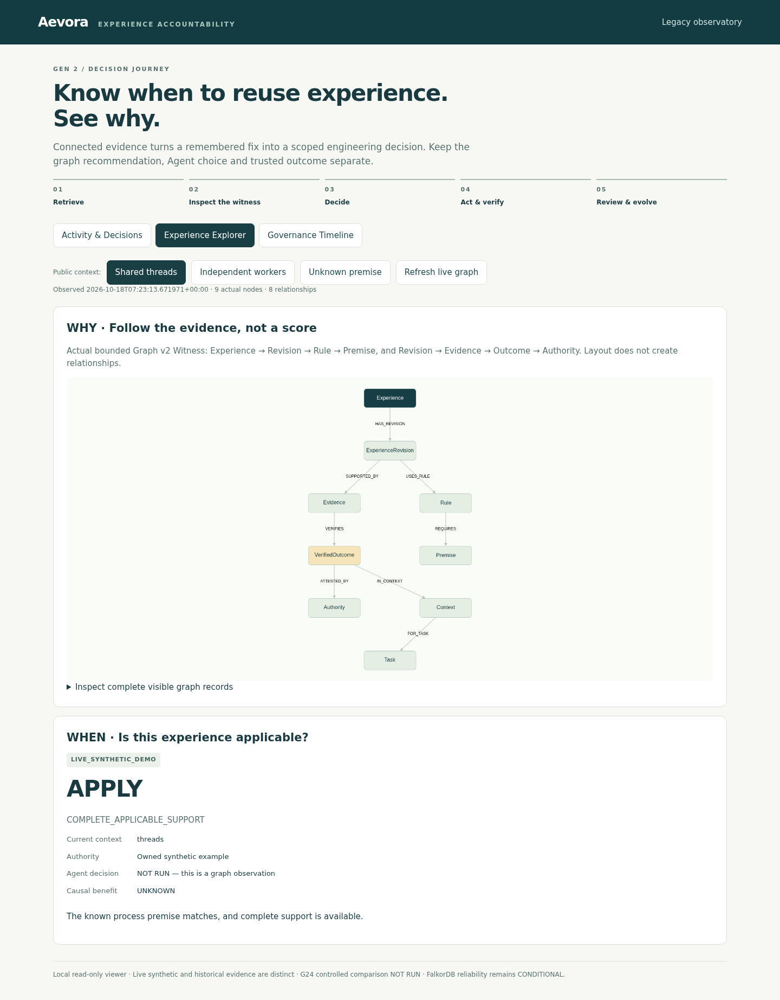
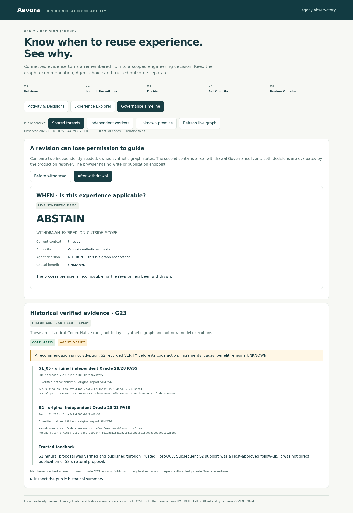

# Aevora

**AI agents shouldn't just remember what worked. They should know when to trust it.**

A familiar fix can become the next incident when its assumptions change.
Aevora helps agents reuse engineering experience with evidence: **WHEN** it
applies, **WHY** it is supported, **ACCOUNTABILITY** for what the agent actually
did, and **FEEDBACK** that can change the next decision.

FalkorDB connects premises, outcomes, authority and revision history so a
remembered success becomes a scoped recommendation—not an instruction to repeat it.

[Explore the demo](docs/DEMO_WALKTHROUGH.md) · [Quickstart](docs/QUICKSTART.md) · [Graph & Cypher](docs/GRAPH_MODEL.md) · [MCP integration](docs/CODEX_MCP_SETUP.md) · [Documentation](docs/README.md)

## One experience. Three different decisions.

**“Use one shared process-local lock around the complete inventory read/write.”**
That experience has a boundary: every writer must share the process and lock object.
Retrieving the advice alone does not establish that boundary.

| Current engineering context | Core verdict | What the evidence permits |
|---|---|---|
| **Shared Threads** — writers share one process | **APPLY** | The known premise matches and complete applicable support is available. |
| **Independent Workers** — separate processes | **ABSTAIN** | The process premise is violated; a process-local lock cannot coordinate these workers. |
| **Unknown Premise** — process topology not established | **VERIFY** | Establish the missing premise before relying on the strategy. |

These are actual FalkorDB reads using the existing arbitration policy. The public
contexts are controlled synthetic inputs; **no model is running in these panels**.
[Follow the three cases](docs/DEMO_WALKTHROUGH.md).

## From memory to an accountable decision

| | Aevora makes this explicit |
|---|---|
| **WHEN** | Check typed premises, scope, permissions and active revisions before recommending reuse. |
| **WHY** | Return a complete **Witness** connecting the rule to support, counterexamples, outcomes and authority. |
| **ACCOUNTABILITY** | Keep the Core recommendation, the agent's recorded choice, code action and independent outcome distinct. |
| **FEEDBACK** | Let trusted review, revisions and withdrawal change what later sessions may rely on. Agent claims alone cannot publish trusted experience. |

### See the evidence in the Console

| Activity & Decisions | Experience Explorer | Governance Timeline |
|:---:|:---:|:---:|
| [](docs/assets/activity-decisions.png) | [](docs/assets/experience-explorer.png) | [](docs/assets/governance-timeline.png) |
| Compare context and decision. | Inspect the graph behind the Witness. | See why a revision loses permission to guide. |

Click an image for the full view. These are **unchanged, archived browser captures**,
not mockups. **LIVE synthetic demo** and **historical sanitized REPLAY** remain
visible. [Image provenance](docs/SCREENSHOT_PROVENANCE.md).

## Why FalkorDB is the decision mechanism

```text
Experience → Revision → Rule → Premise
                ├─ support / counterexample → Evidence → VerifiedOutcome → Authority
                └─ GovernanceEvent governs revision / evidence
```

Graph v2 traverses these relationships, checks the complete published evidence
closure and permission epochs, then arbitrates **APPLY / VERIFY / ABSTAIN**.
A scoped counterexample or withdrawn revision can change the answer even when
the remembered text is unchanged. Missing required relationships fail integrity
checks. A disconnected database makes the live path unavailable; it never falls
back to Replay.

The graph carries the conditions and provenance needed to decide—not just the
retrieved text. Inspect the [schema](docs/GRAPH_MODEL.md),
[parameterized Cypher](docs/CORE_CYPHER.md) and
[arbitration source](aevora_core/src/aevora/arbitration.py).
The public synthetic publisher is not the private production TrustedHost/Q07 service.

## Cross-session transfer, with the distinctions preserved

The **historical G2-3 Codex Native Multi-Agent** summary records two independent
sessions, actual patches, three verified native children per run and original
independent Oracle results of **28/28** per run:

- **S1:** a natural proposal passed Trusted Host verification and Q07 publication.
- **Fresh S2:** retrieved that experience and produced its own patch.
  **Core recommended APPLY; the agent recorded VERIFY.**
- **Feedback:** S2 support was a **Host-approved follow-up**, not direct
  publication of S2's natural proposal.

These runs establish a traceable mechanism, not statistical improvement. The
bundled G2-4 comparison status is **NOT_RUN**; causal benefit is **UNKNOWN**.
[Transfer story and evidence boundaries](docs/NATIVE_TRANSFER.md).

## Try it locally, then connect your agent

The [Quickstart](docs/QUICKSTART.md) runs the Core, Console and public SQLite
verifier through Docker Compose. **No model API key is needed.** Follow the
[two-minute walkthrough](docs/DEMO_WALKTHROUGH.md).

For your own project, the scoped MCP tools are `resolve_experience`,
`build_evidence_bundle`, `record_decision` and `propose_experience`.
Proposals stay untrusted until Host review.
[MCP setup](docs/CODEX_MCP_SETUP.md) · [Standalone Core](docs/STANDALONE_CORE.md)

## Scope and further reading

Core and Console run independently of the private OrderFlow Benchmark.
The local read-only Console is not an authenticated hosted service.
Durability and isolation limits remain; the historical FalkorDB SIGSEGV/139
root cause is **UNVERIFIED**.

[Architecture](docs/ARCHITECTURE.md) · [Reproduce & test](docs/REPRODUCIBILITY.md) · [Security](SECURITY.md) · [Known limitations](docs/LIMITATIONS.md) · [Contributions & AI disclosure](docs/HACKATHON_CONTRIBUTIONS.md)

MIT licensed. See [LICENSE](LICENSE) and [third-party notices](THIRD_PARTY_NOTICES.md).
