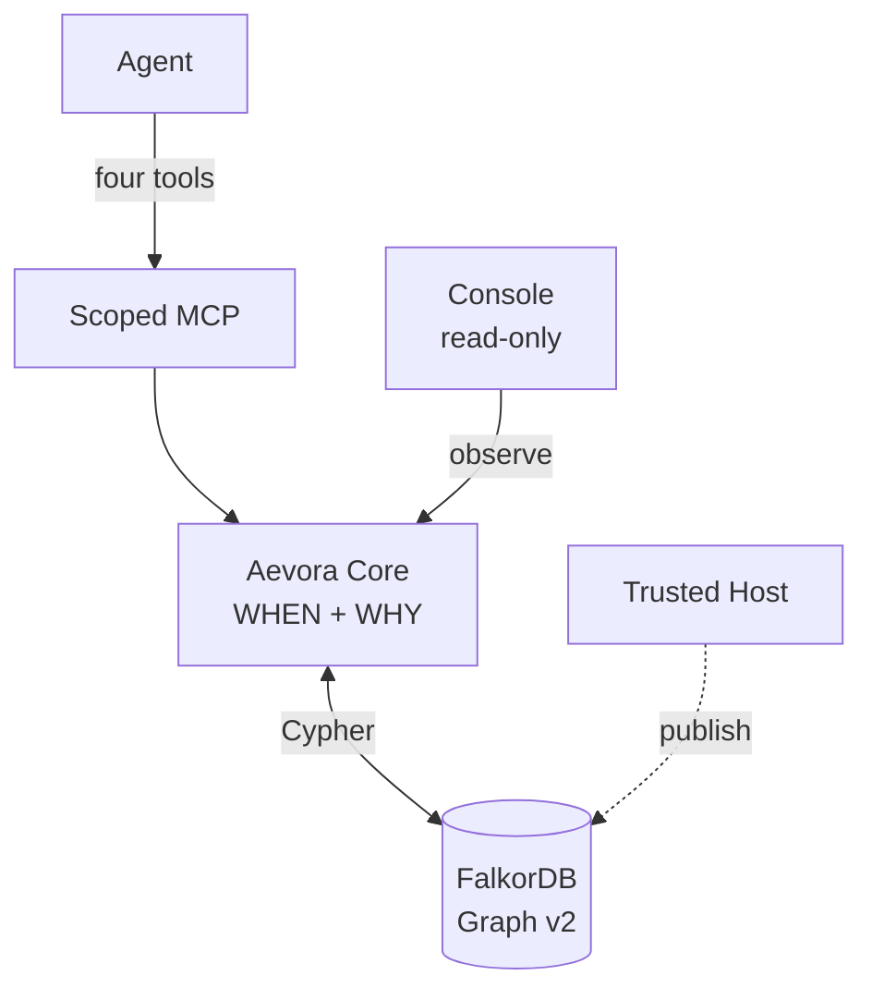
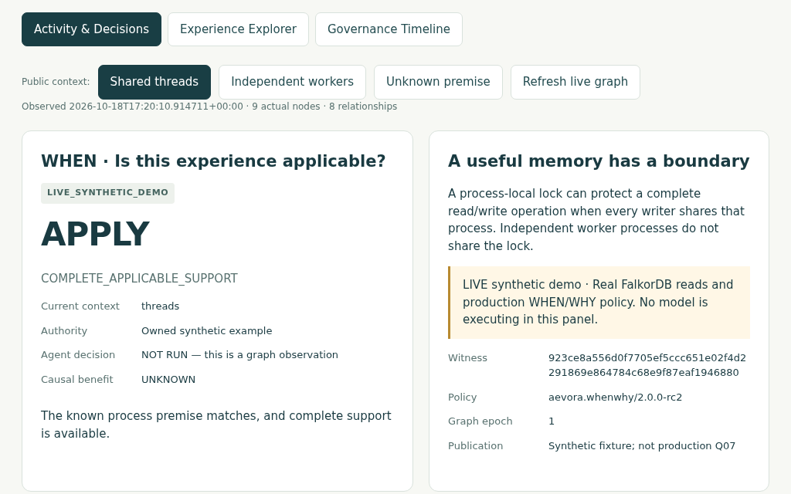

<div align="center">

# Aevora

**AI agents shouldn't just remember what worked. They should know when to trust it.**

Evidence-governed experience reuse for coding agents, powered by [FalkorDB](https://www.falkordb.com/).

**WHEN · WHY · ACCOUNTABILITY · FEEDBACK**

[**Watch the demo**](https://youtu.be/g5KCv_stZhg) · [Quick start](#quick-start) · [How it works](#how-aevora-works) · [MCP tools](#mcp-tools) · [Documentation](#documentation)

*Graph-native decisions · Four scoped MCP tools · Local Docker demo · MIT licensed*

</div>

## What is Aevora?

A coding agent fixes an inventory race condition with a process-local lock. The fix works, so another agent remembers it. But the next system runs workers in **separate processes**: the same lock no longer protects shared inventory.

**The lesson wasn't wrong. The conditions that made it right no longer hold.**

Aevora turns past experiences into **evidence-backed, context-dependent recommendations**, rather than instructions to copy. It links prerequisites, support, counterexamples, verified outcomes, authority and revision history in FalkorDB—and keeps the agent's actual decisions separate from the system's advice.

## Quick start

Run the public **live synthetic demo** on a local FalkorDB instance. It needs Linux, Docker Engine with Compose v2, Python 3.10+, and approximately 4 GB of available RAM. **No model API key or private Benchmark is required.**

```bash
git clone https://github.com/Renwang-Huang/Aevora.git
cd Aevora
python3 scripts/aevora_public_demo.py start \
  --project aevora-gen2-demo \
  --secret-dir "$HOME/.config/aevora/public-demo"
```

Open **http://127.0.0.1:19064/journey.html**. The demo reads a real FalkorDB graph through the actual Aevora Core. It does **not** execute an LLM; historical agent evidence is shown separately as **REPLAY**.

| Context | Core | Reason |
| --- | --- | --- |
| **Shared threads** | **APPLY** | Every writer shares the process and lock. |
| **Unknown topology** | **VERIFY** | Check the missing process premise. |
| **Separate processes** | **ABSTAIN** | The lock cannot span processes. |

Switch contexts in **Activity & Decisions**, inspect the underlying relations in **Experience Explorer**, then use **Governance Timeline** to see how withdrawal changes which experience revision can be used.

[Step-by-step walkthrough](docs/DEMO_WALKTHROUGH.md) · [Reproduction and public tests](docs/REPRODUCIBILITY.md) · [Troubleshooting](docs/TROUBLESHOOTING.md)

## Why Aevora?

| Principle | What Aevora actually does |
| --- | --- |
| **WHEN** | Checks task context, necessary premises, scope, revision status and permissions before reuse. |
| **WHY** | Returns a graph **Witness** linking supporting and contradictory evidence, outcomes and authority. |
| **ACCOUNTABILITY** | Separates Core advice, the agent's recorded choice, code action and independent evaluation. |
| **FEEDBACK** | Requires trusted source/outcome review before an experience can be published, revised or withdrawn. Agent proposals alone remain untrusted. |

**FalkorDB is part of the decision path, not merely a place to store memories.** The Core traverses versioned experiences, rules, premises, evidence, authorities and governance events. Changing relevant relationships can change a recommendation; missing evidence is not silently treated as support.

## How Aevora works



The public distribution includes the Core, the graph logic, scoped MCP transport, a read-only Console and a **synthetic** publisher for the local demo. The production Trusted Host/Q07 verifier and private independent Oracle are **not bundled**; the synthetic publisher does not stand in for them.

Explore the [graph model](docs/GRAPH_MODEL.md), [actual parameterized Cypher](docs/CORE_CYPHER.md), [arbitration source](aevora_core/src/aevora/arbitration.py), and [architecture details](docs/ARCHITECTURE.md).

## MCP tools

The Core exposes four scoped tools through its MCP integration. Model claims do not grant publication authority.

- **`resolve_experience`** — Retrieve scoped, permission-checked candidates and Core recommendations.
- **`build_evidence_bundle`** — Expand the complete Witness through bounded, integrity-checked pages; a page alone is not the complete bundle.
- **`record_decision`** — Store an agent's **untrusted claim**, not verified adoption or an independent Outcome.
- **`propose_experience`** — Submit an **untrusted proposal** where the grant permits it, not publish an experience.

Agents receive no Host review, publication, withdrawal, arbitrary Cypher or Outcome-writing tool.
[Connect Codex or another MCP client](docs/CODEX_MCP_SETUP.md) · [Standalone Core setup](docs/STANDALONE_CORE.md)

## Evidence from real agent sessions

Historical G2-3 Codex **native multi-agent** runs demonstrated an actual transfer between separate sessions:

**S1 (original patch + independent evaluation)** → **Trusted Host (source/outcome review + publication)** → **fresh S2 (experience retrieval + its own patch + independent evaluation)**.

Each recorded run involved three verified native children and an original **28/28** independent Oracle result. S2 retrieved a published Witness, but **the Core recommended APPLY while the S2 agent recorded VERIFY**. Its additional supporting evidence was accepted through a **Host-approved follow-up**, not by automatically trusting its proposal.

This demonstrates a historical *mechanism*, **not** a measured causal advantage over ordinary or no memory. The bundled G2-4 controlled comparison is **NOT_RUN**; comparative causal benefit remains **UNKNOWN**. Raw model sessions and private Oracle assertions are not included in the public release.

[Historical evidence and limitations](docs/NATIVE_TRANSFER.md) · [Sanitized public run summary](console/web/gen2_history.json)

<details>
<summary><strong>View actual Console screenshots</strong></summary>

[Activity & Decisions](docs/assets/activity-decisions.png) · [Experience Explorer](docs/assets/experience-explorer.png) · [Governance Timeline](docs/assets/governance-timeline.png)



The screenshot is an archived browser capture. [Source and capture provenance](docs/assets/RC12_VISUAL_PROVENANCE.json).

</details>

## Security and limitations

Aevora is **not** an authorization service or a production-ready remote multi-tenant deployment. The local Console is read-only. Synthetic graph observations, historical replay and live model actions are explicitly different evidence classes. Production outcome verification is outside the public demo.

The historical FalkorDB SIGSEGV/139 root cause remains **unverified**; the documented restart and durability guarantees are bounded by explicit saved-state behavior. No general reliability or statistical success-rate claim is made.

[Security](SECURITY.md) · [Known limitations](docs/LIMITATIONS.md) · [Contribution provenance and AI disclosure](docs/HACKATHON_CONTRIBUTIONS.md)

## Documentation

| Guide | Start here |
| --- | --- |
| Run the product | [Quickstart](docs/QUICKSTART.md) · [Reproducibility and tests](docs/REPRODUCIBILITY.md) |
| Integrate an agent | [MCP setup](docs/CODEX_MCP_SETUP.md) · [Standalone Core](docs/STANDALONE_CORE.md) |
| Understand the graph | [Graph model](docs/GRAPH_MODEL.md) · [Cypher templates](docs/CORE_CYPHER.md) |
| Explore the demo | [Video](https://youtu.be/g5KCv_stZhg) · [Walkthrough](docs/DEMO_WALKTHROUGH.md) |
| Review the implementation | [Architecture](docs/ARCHITECTURE.md) · [Documentation index](docs/README.md) |

MIT licensed: [LICENSE](LICENSE) · [Third-party notices](THIRD_PARTY_NOTICES.md).
