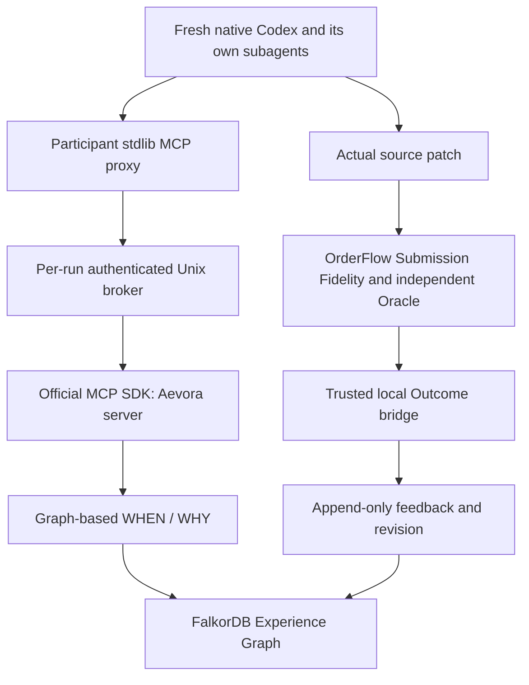

# Aevora H1 architecture and authority

## Project boundaries

**Aevora** is the experience accountability system. It is an independent Python
distribution, `aevora-core` version `0.1.0`, with import package `aevora`.
**OrderFlow Incident Lab** remains the independent software task and evaluation
Benchmark. **FalkorDB** is the real graph database; the name is not a generic
label for a JSON store. **Codex** supplies its own native collaboration Runtime.
The authoritative task is the root H1 v1.1 specification. Historical GraphSwarm
names, code provenance and old results remain historical evidence.

The G0 inspection did not find a legacy governance implementation or the named
historical architecture/H0 documents in the readable workspace. This is a
discovery limit. The working tree includes uncommitted M1/M1.1 source, so HEAD
alone cannot identify the inherited implementation. The new H1 archive freezes
196 baseline source files and 90,800 historical files, together with test
identities and git state. Historical scores are never rewritten by H1.

## Data flow



### Trusted and untrusted operations

| Component | Authority | Exposed to Participant |
|---|---|---|
| `models.py`, `graph_repository.py` | Validate immutable graph identities, official SDK, parameterized Cypher | Allowlisted projections only |
| `experience_resolver.py`, `evidence_bundle.py` | Read actual multihop graph paths and explain decisions | Public MCP result |
| `mcp_server.py`, `mcp_broker.py` | Pin public context and current Run; bound requests and official SDK children | Three authorized tools |
| `mcp_proxy.py` | Standard-library stdio transport for a scoped Unix socket | Read-only proxy file and this Run's revocable bearer |
| `orderflow_outcome_bridge.py` | Cross-check pinned independent evaluation evidence | No tool or source access |
| `feedback.py` | Verify and append observed feedback, revisions and evidence | Later public projection only |
| `audit_capsule.py` | Read explicit audit assets; verify portable bytes and source pointers | Never: maintainer audit data |
| OrderFlow Runner/Evaluator | Submission Fidelity, hidden tests, database Oracle, Runtime isolation | Public task and submission result |

Default OrderFlow experience remains **DISABLED**. Explicit `--experience
aevora` adds one socket and a read-only stdlib proxy to the existing hardened
Participant namespace. It does not bind the host repository, host secret
directory, database client, server code or previous Run archives. The trusted
host holds project DB and Gateway secrets. Participant cannot call
`submit_outcome`, raw Cypher or administration APIs. Native scheduling and
subagent creation remain Codex's responsibility.

## Graph persistence and contracts

`GraphRepository.from_environment()` uses the pinned official FalkorDB SDK.
The password is read from an owned, ordinary, single-link secret file. Connect,
socket and query waits are finite; SDK failures become sanitized
`GraphUnavailable`, with no JSON fallback corpus. All labels and relationships
are allowlisted. Each node has a unique non-null ID, canonical payload and
payload SHA256. Actual database mandatory/unique constraints must reach
`OPERATIONAL` before use. Same-ID/same-payload insertion is idempotent; conflicting
content is rejected and audited. Outcome-to-Context and Context-to-Task edges
cannot acquire a second interpretation through normal repository operations.

The store is append-only at the application boundary. A maintainer with raw
database administration credentials can still mutate or delete data. H1 does
not provide external immutable storage. Multi-statement imports/feedback are
not one ACID transaction: interrupted appends can leave partial records. An
identical retry completes the chain, and only completed evidence paths count.

The release Docker profile pins FalkorDB `v4.20.4` and its exact image digest.
It replaces the image's `run.sh` entrypoint with `redis-server` to actually load
the trusted secret configuration and avoid the bundled browser. Port 16379 is
bound only to loopback. Limits are 1 GiB, 2 CPUs and 256 PIDs.

**Persistence is currently RDB with `appendonly no`.** A real AOF restart attempt
crashed during `GRAPH.EFFECT` reload and its logs/AOF were retained. Recovery
from a graceful-stop RDB reproduced the exact graph and public paths. An
explicit authenticated `SAVE` must precede an intentional restart after new
feedback. Unsaved crash-tail durability is **UNVERIFIED**. The upstream
[AOF replay issue #2201](https://github.com/FalkorDB/FalkorDB/issues/2201) reports
a related failure with a different trigger/stack; it does not establish that
our local crash has the identical root cause.

## WHEN / WHY

The core APIs are `ExperienceResolver(repo).resolve(context)` and
`build_evidence_bundle(repo, experience_id)`. Context contains scalar public
facts; null/absent values stay unknown. Episode IDs never select a verdict.
The resolver reads real paths:

```text
Experience → ExperienceRevision → Rule → Premise
Experience → ExperienceRevision → Evidence → VerifiedOutcome → Context → Task
```

APPLY requires a complete declared premise chain, matching known premises and
relevant complete verified support. A conflicting premise or relevant business
counterexample gives ABSTAIN. Unknown facts, missing graph hops, unverified
topology, incomplete declared premises or absent relevant support give VERIFY.
`OBSERVED_OUTCOME` is displayed but never promoted to support/refutation merely
because the associated task passed/failed. Graph ablations genuinely remove
evidence: deleting a necessary edge changes the retrieval fingerprint and can
change APPLY to VERIFY. Test ablations use copied graph namespaces.

Context such as SQLite atomic-transaction capability describes the available
database; it does not assert that candidate code already uses that capability
correctly. A relevant history is not a guarantee of a new repair. Responses
include actual premise/support/counterexample paths, query/rule versions,
unknown/conflicting facts and a retrieval snapshot hash. Multi-query reads are
bounded observations, not a single database snapshot transaction.

Historical seed provenance distinguishes a real natural Agent origin from
maintainer replays of its exact patch. Public `origin_run_id` and
`origin_patch_sha256` identify that natural source; each replay keeps its own
VerifiedOutcome Run. The RLock experience is `maintainer_seed`. Different
source types must not be relabeled as new Sessions or governance experiments.

## MCP and Runtime integration

MCP exposes exactly `resolve_experience(task_context)`,
`build_evidence_bundle(experience_id)` and `record_decision(decision)`.
The trusted launch fixes Run ID and public environment context. Participant
claims cannot replace unknown trusted facts to obtain APPLY. Query records bind
actual candidates to this Run; bundle access and Decision validation depend on
those real records/edges. A Decision is an untrusted claim, not verified
adoption. Connection IDs from the socket are not native Codex thread identities.

The scoped bearer enters the native process through the trusted launch header
and is forwarded through an explicit MCP environment allowlist. It is absent
from command/configuration arguments and revoked when the broker closes.
Actual raw JSON-RPC evidence is archived on the host with original references
and redaction metadata. Official native rollout evidence must independently
establish model tool use, subagent identities and completion; a proxy event or
participant prose cannot prove native collaboration.

The existing completion-aware Runtime remains: no arbitrary total wall deadline
or request count when explicitly configured as `none`, while connection/stream
limits, bounded concurrency, resource enforcement and human cancellation remain.
Runtime, Multi-Agent verification, task Evaluation and integration success are
separate result fields.

## Trusted feedback

`verify_outcome(anchor, report_reference)` takes no caller verdict or verified
flag. Its maintainer-authorized pinned manifest and frozen source snapshot are
the local trust root. It checks exact required JUnit identities/counts, pytest
exit, patch-derived candidate tree, evaluator/suite fingerprints and sealed
host Oracle/topology/recovery records. Historical and current-live trust profiles
preserve their respective source versions.

`ingest_outcome(repo, anchor, report_reference, ...)` invokes this verification
itself. Actual same-Run Query/Decision relationships are checked before linking
an experience. Feedback appends `outcome_observed_no_attribution`, a new revision
and `OBSERVED_OUTCOME` evidence, retaining the original Rule and history.
Attribution remains **UNKNOWN**; reliability is not upgraded from task PASS.
No observed exposure means no invented experience revision. Identical replay is
idempotent, conflicting reinterpretation is rejected and audited.

## Evidence layers and gate status

Full Archive stays on the trusted host. Audit-Lite is maintainer-only evidence,
using the existing read-only OrderFlow exporter plus a new `PROTOCOL.json`
Aevora capsule. The capsule contains actual design/schema/query/Gate/JUnit/MCP/
Outcome/source-change bytes, source/export SHA256 and complete JSONL line maps.
Its verifier checks local consistency without executing package code. Original
bytes transformed by redaction or portability remain Full-only/unverified in
the lightweight package. See [EVIDENCE_ARCHIVE.md](EVIDENCE_ARCHIVE.md).

| Gate | Required dynamic evidence |
|---|---|
| G0 | Inherited source/history freeze and valid full regression |
| G1 | Actual schema/import/idempotence, DB unavailable without fallback, qualified restart persistence |
| G2 | Real context states, multihop evidence and graph additions/deletions |
| G3 | Physical MCP isolation, fresh native model tool calls, genuine subagents and independent D evaluation |
| G4 | Trusted current Outcome, append/conflict/idempotence and persisted revision |
| G5 | New Session observes changed evidence and reproducible A→D loop |

Architecture and implementation files are not Gate PASS receipts. Consult the
new H1 archive and final H1 report for actual outcomes; a later Gate cannot
retroactively prove an unexecuted earlier one. Development tests and native
Benchmark Sessions are separate evidence classes.

## Remaining assurance limits

Local hashes prove bytes under maintainer authority, not external attestation.
A compromised maintainer can authorize false evidence. Query does not prove
adoption; a matching patch does not prove mental influence or causality. H1
does not measure a success-rate improvement. Existing resource sampling and
unsupported SQLite observer limits remain. No B/C, D-v02 business implementation,
new orchestrator, multi-tenant service or formal G0–G3 research cohort is included.

## Mature components and primary references

Official [FalkorDB Python SDK](https://github.com/FalkorDB/falkordb-py), its
[constraint lifecycle](https://docs.falkordb.com/commands/graph.constraint-create),
[official Python MCP SDK](https://github.com/modelcontextprotocol/python-sdk),
[Codex MCP configuration](https://learn.chatgpt.com/docs/extend/mcp?surface=cli)
and [SLSA artifact verification guidance](https://slsa.dev/spec/v1.2/verifying-artifacts)
are reused. Versions and deployed APIs must additionally pass local dynamic
tests; documentation alone is not execution evidence.
