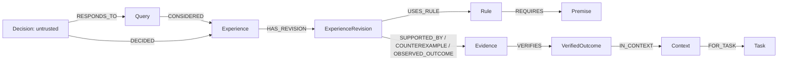

# Aevora Experience Graph schema

The deployed database is **FalkorDB**. Its official Python SDK executes the
Cypher queries in `aevora.graph_repository`; this is not an in-memory graph or
a JSON suggestion lookup. H1's preserved catalog is `aevora.graph/1.0`;
H2's append-only extension is `aevora.graph/1.1`. See
[H2 governance and checkpoint compatibility](H2_GOVERNANCE.md) for exact version
catalogs and migration. The H1 records below retain their original payloads.

H3 opt-in candidate initialization adds `aevora.graph/1.2`: 22 node labels,
44 unique/mandatory constraints, and five additional relationships:
`HAS_LIFECYCLE`, `HAS_CANDIDATE_EVENT`, `PREVIOUS_EVENT`,
`HAS_SOURCE_VERIFICATION`, `PUBLISHED_FROM`. Its five added labels are
Candidate, LifecycleHead, CandidateEvent, SourceVerification and
ExternalObservation. The older catalog constants remain unchanged for legacy
imports and checkpoint compatibility; the extension is selected explicitly.
See [H3 lifecycle](H3_LIFECYCLE.md) for the immutable body, fenced head,
staged publication, Host-only admission and observation authority. H3 demo
exports actual typed edges and bounded public node projections; its stored
payload SHA refers to the full trusted record, not to the projected bytes.

## Immutable records

Every node has a non-null scalar `id`, canonical `payload_json`, and
`payload_sha256`. Actual database UNIQUE(id) and MANDATORY(id, payload_json,
payload_sha256) constraints are created and their asynchronous lifecycle is
checked until OPERATIONAL. A duplicate import of identical bytes is idempotent.
Conflicting bytes cannot overwrite a node; the rejected attempt receives a
separate deterministic AuditEvent. Edges similarly carry a stable endpoint-
derived ID and immutable payload hash. Database administrator writes are outside
the Participant interface and remain a trusted-host administrative capability.

| Node | Purpose |
|---|---|
| Experience | Stable strategy identity, explicit provenance, public principle and limitations |
| ExperienceRevision | Append-only explanation/version boundary; feedback does not replace history |
| Rule / Premise | Versioned rule with graph-linked scalar facts and allowed values |
| Evidence | Public evidence summary and exact host-side source references |
| VerifiedOutcome | Trusted bridge-minted actual verdict, Run, submission, suite and evaluator identity |
| Context / Task | Actual public environmental facts and independent task association |
| Query / Decision / Agent | Scoped request, untrusted adoption claim and observable agent identity |
| ObservedAction / Feedback | Separately observed behavior and qualified feedback, never inferred causality |
| AuditEvent / Schema | Rejected conflict and schema identity |
| GovernanceEvent (H2) | Trusted, scoped withdrawal/expiry/restriction with target and completion authority |
| QuerySnapshot (H2) | Immutable allowlisted facts/candidate/as-of/version collection; exact Query replay |

`SUPPORTED_BY` requires an actual PASS; `COUNTEREXAMPLE` requires business FAIL.
ERROR and TIMEOUT are not strategy counterexamples. `OBSERVED_OUTCOME` preserves
an independent result with insufficient attribution. Outcome→Context and
Context→Task cannot be reinterpreted by attaching different endpoints. All
validation precedes writes; interrupted multi-query imports may leave incomplete
nodes, but incomplete paths never qualify as a support chain and imports can be
retried idempotently. Imports are not represented as an all-or-nothing database
transaction.

H2 adds `SUPERSEDES`, `GOVERNS` and `AT_SNAPSHOT`. Rule publication declares its
predecessor edges, effective scope and validity; observation-only revisions do
not publish rules. Current constraints require exactly 34 OPERATIONAL NODE
identities (kind/label/property set), compared with the exact 30 in the old
catalog. Snapshot replay and feedback verify actual typed Query/Decision binding
edge IDs, payloads and SHA256; a declared map alone cannot authorize replay.
Snapshot collection uses separate statements and is not an atomic graph read.

## Provenance and disclosure

Experience/Evidence source type is exactly `natural_agent_run`, `maintainer_seed`
or `synthetic_or_test_fixture`. A maintenance replay is not a new natural Agent
Session. A and D outcomes are separate nodes with their own immutable Run and
submission identifiers. Shared strategy classification does not merge their
patches or claim the same literal patch ran in both environments.

The host retains verifier references, private verification, manifests and exact
test identities. Public projections use explicit field allowlists and contain
strategy principles, limits, stable node/Run IDs, outcome/count/fingerprints and
documented environmental facts. Private payload fields and private paths are
never included in the Participant bundle.

## Actual SDK and operational behavior

The tested dependency is pinned by the independent Aevora package. Official
`Graph.query(..., params=..., timeout=...)` and `Graph.ro_query` are used; only
allowlisted label/edge identifiers are interpolated and values are parameters.
Finite connection, socket and query deadlines apply. Missing configuration,
failed authentication, a stopped server or a query failure is explicit
UNAVAILABLE, with no static corpus fallback. The graph credential is read from
a trusted host ordinary file, never placed in an Agent environment or archive.

Primary implementation references: [official Python client](https://github.com/FalkorDB/falkordb-py),
[constraint lifecycle](https://docs.falkordb.com/commands/graph.constraint-create),
[read-only queries](https://docs.falkordb.com/commands/graph.ro-query).
