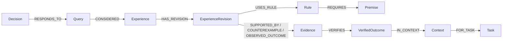

# 图记录与 Schema

实际数据库是 FalkorDB，SDK 执行参数化 Cypher。节点至少包含稳定 `id`、
canonical `payload_json` 和 `payload_sha256`；边的身份绑定端点与关系类型。
实际 UNIQUE / MANDATORY 约束达到 OPERATIONAL 后才使用。

## 记录

| 记录 | 作用 |
|---|---|
| Experience / ExperienceRevision | 经验身份和追加的解释/规则版本 |
| Rule / Premise | 适用规则、事实键和允许值 |
| Evidence / VerifiedOutcome | 公共证据解释与可信来源验证产生的工程结果 |
| Context / Task | 结果对应的公开事实环境和任务关联 |
| Query / QuerySnapshot | scoped 查询、不可变输入/候选/版本快照 |
| Decision / Agent / ObservedAction | 不可信选择声明与单独观察，不推断采纳 |
| Feedback / GovernanceEvent | 追加反馈、有界撤回/到期/作用域限制 |
| Candidate / LifecycleHead / CandidateEvent | 不可信候选、受 fence 保护的当前状态与事件链 |
| SourceVerification / ExternalObservation | Host 来源核验与外部项目观察，权限分别记录 |
| AuditEvent / Schema | 冲突/拒绝与实际 schema 版本 |

## 版本与一致性

源码支持 `aevora.graph/1.0`、`1.1`、`1.2` 的明确 catalog。普通 repository
默认与可信候选 initializer 选择的版本不同；`aevora init` 使用生命周期
catalog。精确 labels、relationships、约束和迁移规则以 models.py 的
`schema_catalog()` 及 repository 初始化实现为准，不用文档数量代替实际校验。

同 ID 同载荷幂等，不同载荷拒绝覆盖并产生独立 AuditEvent。Outcome→Context
与 Context→Task 不允许附加第二种解释。规则继承用显式 SUPERSEDES，
治理范围与完成记录共同约束有效结果；不以创建时间选取任意胜者。

SUPPORTED_BY 对应可信 PASS，COUNTEREXAMPLE 对应业务 FAIL；ERROR/TIMEOUT
不是策略反例。OBSERVED_OUTCOME 保留不足以归因的独立观察。未知事实不补全，
不完整证据路径不作为支持。多语句导入可以部分完成并重试，不声称全局事务。

## 来源与投影

来源明确区分 natural_agent_run、maintainer_seed、synthetic_or_test_fixture 和
independent_project。后者绑定 Host 授权的项目 verifier receipt、提议体、Run、
提交、suite/evaluator 指纹和 JUnit，不声称原生 Agent 身份。
自测结果、查询和 Agent Decision 不等同可信 Outcome。公共投影按字段
allowlist 返回，原始载荷摘要不等于投影字节摘要。私有 references、身份材料、
隐藏 suite 和凭据不进入 Agent bundle。

查询与生命周期分别见[查询参考](QUERY_COOKBOOK.md)、[安全](SECURITY.md)。
