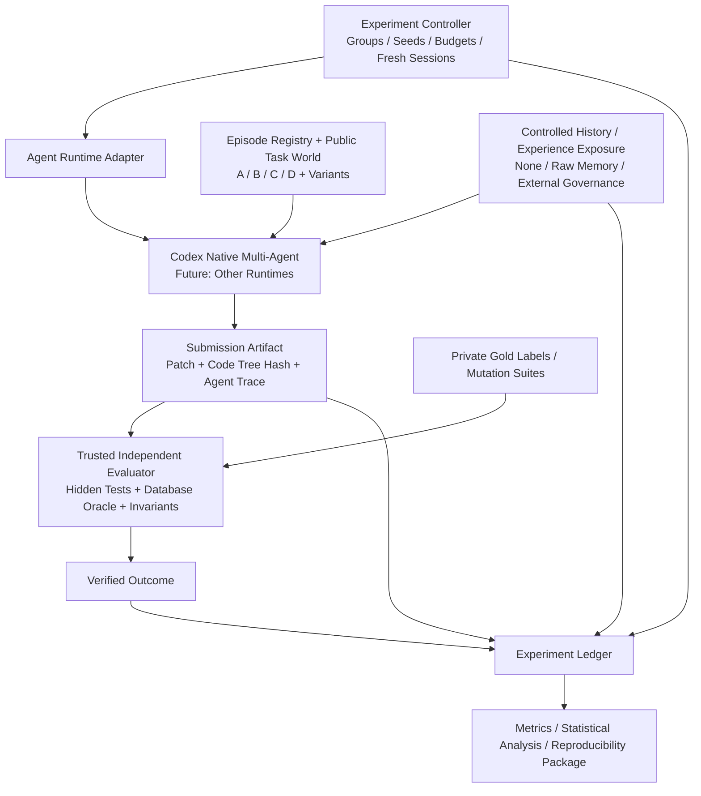
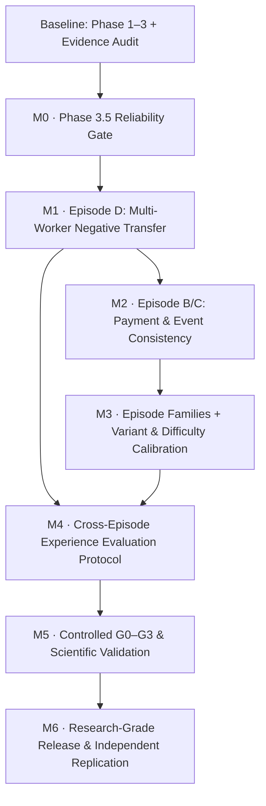

# OrderFlow Incident Lab — Benchmark Development Roadmap

> **Version:** v1.0 · **Baseline:** 2026-10-10  
> **Document type:** 项目建设蓝图 / 研究型 Benchmark 路线图  
> **Scope:** 仅限 **OrderFlow Incident Lab Benchmark** 的任务环境、运行适配、独立评测、实验设计与研究级发布。**不包含 GraphSwarm / FalkorDB 经验治理核心的开发排期。**  
> **Status:** 战略规划草案；文中所有“目标 / Gate”均为后续验收标准，不代表已经实现。  
> **Sources of baseline:** 现有 Benchmark Design Specification v1.0、Phase 1–3 开发反馈、Evidence-Only Audit、Phase 3.5 开发计划，以及最近一轮 Benchmark 成熟度讨论。

---

## 0. 执行摘要：我们要把 OrderFlow 建设成什么

**North Star：**

> **OrderFlow 不应止步于一个能让 Codex 多 Agent 修复四个 Bug 的测试仓库，而应成为一套能够持续生成真实工程决策困难、控制历史经验输入、观察 Agent 协作与策略选择，并用独立证据检验经验继承、负迁移和反馈演化的研究型 Benchmark。**

它要有能力回答五组彼此独立的问题：

1. **Engineering Correctness：** Agent 交付的修复在真实业务约束下是否正确？
2. **Collaboration：** 多 Agent 协作有没有带来增益，还是只增加了成本？
3. **Persistence：** 跨会话、跨任务的历史经验是否被真实获取与使用？
4. **Awareness：** Agent 能否正确区分历史经验的适用、待验证和不适用边界？
5. **Accountability：** 某次经验选择与后续结果之间，是否存在可追踪、可独立核查的证据链？反馈以后是否改善后续表现？

**最终成熟度目标：Level 4 — Research-Grade Multi-Agent Experience Benchmark。**  
**当前实际位置：Level 1 后期（执行框架已成立），Level 2 起点（仅 Episode A 为正式可执行任务）。**

本路线图做出四项决定：

- **继续投资 Benchmark，而非以“已经够 Demo”为终点。**
- **不重复建设 Agent Orchestrator，也不把经验治理算法偷偷写进 Benchmark。**
- **优先提高任务族的真实性、难度梯度、经验迁移价值以及评测科学性，而不是单纯增加开发者测试数量。**
- **按阶段交付、按证据过 Gate；不把计划、代码存在、一次 PASS 与研究结论混为一谈。**

---

## 1. 项目定位、边界与系统地图

### 1.1 Benchmark 的职责

OrderFlow 是**任务世界 + 实验调度器 + 独立裁判 + 研究数据生产器**。

| 层 | OrderFlow 应负责的内容 | 不应负责的内容 |
|---|---|---|
| Task World | 订单、库存、支付、事件、数据库与 Worker 的真实工程行为 | 为特定模型写死答案 |
| Scenario / Episode | 故障注入、环境变体、公开 Issue、私有测试、任务关系 | 向 Participant 暴露根因或标准修复 |
| Agent Runtime Adapter | 启动真实 Agent、隔离工作区、收集执行与补丁 | 重新实现 Codex 原生多 Agent 调度 |
| Experiment Controller | 新会话、随机化、实验分组、历史信息注入权限、预算、顺序控制 | 决定某种经验治理算法内部如何运行 |
| Independent Evaluator | 验证代码/业务结果、策略适用性参考标签、环境一致性 | 相信候选代码自报成功；读取受测治理系统的私有结论当真值 |
| Evidence & Reporting | 提交保真、运行轨迹、版本指纹、指标与统计 | 将“经验被检索”自动判定为“经验带来收益” |

### 1.2 逻辑架构：强调可替换、可盲测



**关键隔离约束：** Public Task、Participant Workspace、Controlled History 与 Private Oracle 必须在文件、进程权限、输出接口和评测流程上明确分层。

**外部系统接口原则：** G2/G3 可以通过相同抽象协议提供历史信息或治理建议；Benchmark 只规定输入、输出、日志和评价方法，不实现或预设其核心决策机制。

### 1.3 三条不能被工程便利性破坏的原则

1. **Task Truth Independence：** 独立裁判不能被 Agent 或经验系统修改；隐藏测试、适用性标签和参考补丁不能进入 Participant 工作区。
2. **Submission Fidelity：** Agent 实际提交、可信宿主应用后的代码树以及 Evaluator 测试的代码树必须可校验地对应。
3. **Evidence Before Claim：** 运行记录能证明“发生了什么”，实验设计才能支持“为什么发生”；不能凭一次成功推断方法有效。

---

## 2. 目前的真实基线（截至本路线图编写时）

### 2.1 既有开发与审计里程碑

| 里程碑 | 已得到的结果 | 尚存限制 / 不能推出的结论 |
|---|---|---|
| **Phase 1 — Framework MVP** | OrderFlow 基础业务、SMOKE-001、Runner、独立 pytest/JUnit 评测、Manual Adapter、归档 | 初期业务只覆盖部分订单/库存路径；不等于完整订单系统 |
| **Phase 2 — Episode A** | 真实单进程并发库存故障；200 线程/50 件库存样例；14 项隐藏测试；独立 SQLite Oracle；Buggy/Reference 各 10 轮正反验证 | 只有一个正式任务家族实例；不能衡量跨任务迁移 |
| **Phase 3 — Codex Multi-Agent** | 原生三名 Subagent 有结构化启动/返回证据；真实补丁通过 Episode A 14/14；正式补丁后来离线重放通过 | 只有一个已验证的独立在线成功挑战；不能推断多次新 Session 的稳定成功率或协作因果贡献 |
| **Evidence-Only Audit** | 独立重放、提交路径核查、三层文件/网络探针、原始事件交叉验证；发现提交保真和安全边界问题 | 开发者测试 **247/249 PASS、2 FAIL**；不能继续简单宣称全绿 |
| **Phase 3.5 — Hardening** | 已有任务规格：提交保真、Gateway 兼容、Broker/隔离、三次在线回归与证据增强 | **截至当前资料：尚无完成报告 / 新代码验收。不得计为已完成。** |

> **概念澄清：** 249 项是开发者/框架测试，不是 249 个独立 Benchmark 任务；200 个业务并发线程也不是 200 个 Agent。开发者测试数量不能直接代表 Benchmark 任务难度或研究质量。

### 2.2 已经形成的可复用优势

- **真实执行闭环：** 从公开 Issue、独立工作区、原生多 Agent 到补丁与隐藏评价。
- **可复现故障：** Episode A 不靠伪造结果制造 FAIL，而是事务外旧库存快照导致 Lost Update。
- **外部判分：** 可信宿主侧 SQLite 约束与账本检查；多种合法修复策略可以通过。
- **原始证据资产：** Run ID、补丁、JSONL、JUnit、数据库审计、版本指纹及独立重放记录。
- **研究起点：** Episode A 的条件原子更新策略和受控验证的进程内 RLock 策略具有不同适用边界，可用于后续真实迁移与负迁移任务。

### 2.3 目前的主要短板（不掩盖）

| 短板 | 性质 | 为什么重要 |
|---|---|---|
| 空文件增删等补丁可被 Git 静默跳过 | **已复现的产品缺陷** | 影响 Agent 提交与实际评测代码的身份一致性 |
| Broker/Participant/Worker 网络访问与资源限额不完整 | **已知信任边界限制** | 对抗性 Agent、并行实验与费用/资源控制存在风险 |
| Episode B/C/D 未实现 | **任务覆盖缺口** | 无法覆盖支付、事件、跨进程经验边界 |
| 正式任务只覆盖一个故障家族 | **测量效度缺口** | 无法建立难度分布，可能有 Ceiling Effect |
| Subagent 内部操作并不完整可见 | **协作测量缺口** | 能证明委派发生，不能完整证明信息因果影响 |
| 尚无 G0–G3 系统对照与经验干预协议 | **研究设计缺口** | 不能验证经验价值和负迁移改善 |

---

## 3. 质量标准：什么才算“优秀”，而不仅是“够用”

本项目采用四个成熟度 Level，**不通过堆积行数或测试数量晋级**。

| Level | 核心定义 | 必须具备的能力 | 当前状态 |
|---|---|---|---|
| **L1 — Executable Infrastructure** | 能真实运行和独立判分 | Runner、隔离、Agent 接入、Submission、Oracle、可重放证据 | **主体已达到，可靠性有待补丁收敛** |
| **L2 — Robust Engineering Task Benchmark** | 有真实、丰富、可区分的任务体系 | A/B/C/D、变体、独立 Oracle、错误补丁识别、多解支持、难度校准 | **刚起步；正式任务只有 A** |
| **L3 — Multi-Agent Experience Benchmark** | 能公平评估跨任务经验与决策质量 | 任务序列、可控历史曝光、适用性标注、决策观察、G0–G3、负迁移测试 | **尚未形成** |
| **L4 — Research-Grade Benchmark** | 可研究、可复现、可外部审查 | 统计方案、足够多的独立样本、稳健性、复现包、外部复核与泛化证据 | **长期目标** |

### 六项始终适用的质量准则

**Q1. 真实性（Realism）：** 缺陷来自实际业务路径，包含持久化、副作用、重试、并发和合法状态机；不能只靠测试脚本返回错误。

**Q2. 可解性（Solvability）：** 至少一个真实参考修复能通过，允许多种合理解法；公开 Issue 给出可调查的症状，而非隐藏全部必要条件。

**Q3. 判别力（Discriminative Power）：** 不同能力与不同经验策略能产生可测差异；避免所有 Agent 都成功或都失败。

**Q4. 客观性（Oracle Independence）：** 宿主独立核对数据库和副作用、验证异常与回归；异常、超时、跳过测试不得被当成成功。

**Q5. 实验有效性（Experimental Validity）：** 控制模型、历史可见范围、Session、工具、预算、顺序与随机种子；区分相关性与干预效果。

**Q6. 审计性（Auditability）：** 补丁—代码树—执行环境—隐藏测试—决策事件—结果能够定位到原始产物；无法验证则写 `UNVERIFIED`。

---

## 4. 总体 Roadmap 与阶段依赖

### 4.1 建设路径（工程顺序，不是 Demo 叙事顺序）



**重要：** M4 的协议设计可以与 M1–M3 并行，但在足够多的真实任务与受控变体完成之前，不应抢先做统计效果宣称。M0 的提交一致性与可信评价是后续任务的共同门禁。

### 4.2 里程碑总览

| 阶段 | 主目标 | 最有价值的交付 | 通关凭据 |
|---|---|---|---|
| **M0** | 让现有结果可信、可重复、适于批量运行 | Submission Fidelity 修复、隔离准入、环境记录、在线回归 | 先前失败测试转绿；真实文件树保真；安全边界有测试 |
| **M1** | 实现 D，第一次真正跨环境决策困境 | 多进程 Worker 故障、跨环境反例、正反策略 | 同一经验在 A/D 条件下有可解释的不同适用性 |
| **M2** | 业务拓展为完整事故系统 | 支付模拟、事件 Worker、Episode B/C | 端到端订单/支付/库存/事件不变量得到独立验证 |
| **M3** | 从四个案例扩为有难度梯度的任务族 | 每家族多个变体、错误补丁集合、难度统计 | 既能抓错误解，也能接受多种正确解；无明显天花板 |
| **M4** | 定义经验评测所需的可控实验装置 | Experience Exposure 控制、任务序列、决策检查点、Gold Labels | 可在不实现治理算法时运行受控条件 |
| **M5** | 形成可信的对照实验方法 | G0–G3 实验驱动、统一预算、原始记录、统计分析 | 明确报告成功/失败、成本、适用性及不确定性 |
| **M6** | 对外发布可复现实验基准 | 一键运行、版本化任务包、方法报告与复现说明 | 独立机器/人员能重跑关键结论 |

> **优先级说明：** M0 不代表必须一次完成商业级沙箱；必须先解决会污染结果的产品缺陷，随后按照“受控自用 / 并行运行 / 不可信外部参与者”分别设立安全准入。不能以持续加固为理由无限延期任务开发。

---

## 5. M0 — Reliability Gate：先修复会扭曲评测结论的问题

### 5.1 工作范围

1. **Submission Fidelity（P0）：** 修复临时目录被外层 Git 仓库识别时空文件新增/删除静默跳过；应用补丁后校验真实文件树、补丁目标、路径白名单以及 Evaluator 实际测试的代码摘要。
2. **测试全量回归（P0）：** 保留原有 46/107 项历史测试身份；本轮 Evidence Audit 暴露的 2 项失败必须有新的独立复现和修复证据。
3. **Agent / Candidate / Broker 信任边界（P0）：** 区分文件、网络、凭据、请求预算、CPU/内存；对受控与不可信场景分别声明保障能力。防止 Participant 或 Candidate 绕过模型服务授权。
4. **可切换 Provider（P1）：** 第三方模型来源可用于真实 Codex 并发实验，配置与密钥仅保留于可信宿主；不得把联网成功当作安全隔离成功。
5. **Evidence Seal（P1）：** 保留 `submission_hash`、`evaluated_tree_hash`、初始基线哈希、Evaluator/Private Config/Test Suite 指纹、Agent Session/Child 可得证据、真实执行预算及脱敏日志。

### 5.2 M0 Exit Gate

- [ ] 先前 **247/249** 的两项失败已被修复；完整测试在正式环境全绿，无删除、跳过或弱化测试。
- [ ] 空文件新增/删除、普通文件变更、多文件补丁、无效路径与外层 Git 场景具有**独立验证的实际文件树一致性**。
- [ ] 一次现有 Episode A 原始补丁的全新隔离重放通过；实际评测代码树哈希与提交预期对应。
- [ ] 文件读取、网络访问、Broker 调用与资源/超时的真实正反探针执行，并诚实记录尚未封闭的攻击面。
- [ ] 模型 Provider 切换失败时不静默回退；真实 Codex 多 Agent 的事件与提交可以在归档中复核。
- [ ] 历史 Evidence Audit 与旧运行记录保持不可变，不以新 PASS 覆写失败证据。

**不要求：** 为了通过 M0 引入 Kubernetes、Kafka、公开云服务，或构建完整敌对代码安全平台。

---

## 6. M1–M2 — 建设完整工程事故任务世界

### 6.1 Episode 任务家族定义

| Episode | 真实场景 | Agent 必须面临的决策 | 核心业务 Oracle | 经验评测价值 |
|---|---|---|---|---|
| **A — Inventory Concurrency** | 单进程多线程，库存旧快照/Lost Update | 事务、条件原子更新、锁与并发边界 | 库存守恒、订单/账本一致、并发与回归 | 形成历史成功经验；已实现基线 |
| **D — Multi-Worker Coordination** | 多个独立 Worker 共享 SQLite / 状态持久化 | 进程内锁是否仍适用、DB 级原子机制 | 真实多进程共享状态、重启、库存一致 | **首个负迁移 / 边界识别任务** |
| **B — Payment Retry & Crash** | 支付已生效但本地落库前崩溃，重投递 | 持久幂等与副作用、锁是否足够 | 同一意图最多一次模拟真实扣款，恢复一致 | 部分迁移与机制差异判别 |
| **C — Out-of-Order Events** | 取消、支付确认、库存释放乱序/重复 | 版本检查、事件幂等、状态机与补偿 | 合法状态转移、库存/支付/事件账本 | 历史经验修正和连续反馈情景 |

**工程实现顺序：A（已有）→ D → B → C。**  
**对外介绍顺序：A → B → C → D**（经验产生 → 迁移 → 修正 → 拒绝错误迁移）。

### 6.2 M1：Episode D 的高标准设计

这是目前最有鉴别价值的下一道题，不能简化为把 `threading.Thread` 改为 `multiprocessing.Process` 就宣称完成。

- 使用**真实独立 Worker 进程**及共享持久化数据库；不能由一个单进程代理串行执行来冒充多进程并发。
- 设计多 Worker 创建订单、竞争库存、Worker 异常退出/重启与重试交错的可重复复现器。
- 参考修复至少覆盖共享数据库下的原子一致性；允许等价替代策略，不能指定唯一答案。
- **同时测试仍适用的经验与不适用的经验。** Episode A 的条件原子更新经验可作为正向候选；进程内 RLock 的有效历史边界可作为受控负迁移输入。
- 受控种子经验必须保留真实验证出处与“由维护者构造/校验”的身份，不得伪称自然 Agent 经验。
- Participant 公开 Issue 只描述可观察症状，不在标题或任务文字中剧透“进程锁失效”。
- 为多个拓扑条件建立独立标签：单进程、多进程、共享状态条件未知。标签仅供私有评测，不预注入给 Agent。

**M1 通过的含义：** D 是真正可挑战的工程任务，并能产生环境变化下的策略适用性差异；**不代表任何经验治理方法已表现更好。**

### 6.3 M2：B/C 不可只做成“更多 Bug”

**Episode B：** 模拟支付网关必须有**独立于业务订单表**的副作用账本。引入超时、确认前后崩溃、重复投递、重试与恢复；避免真实资金操作。要能够发现“进程锁阻止并发，但不能保证重启后的 exactly-once 业务语义”的错误修复。

**Episode C：** 引入持久事件日志、可控延迟/重复/乱序、消息消费恢复和订单状态机；为取消后迟到支付确认设计明确补偿/退款待处理规则，确保隐藏 Oracle 不会因含糊业务定义误判合法答案。

**共同约束：** 新业务模块必须与既有 A、D 回归兼容，并定义系统级库存、订单、支付、事件一致性不变量；所有任务均保留 Buggy / Reference / 替代合法修复 / 错误修复测试。

### 6.4 每个 Episode 的最低交付包

```text
EpisodePackage/
├── public_manifest + incident_issue + public_tests
├── fixture_factory + fault_injection + reset_recipe
├── private_manifest + independent_oracle
├── buggy_variant + reference_patch
├── alternative_valid_fixes + known_bad_mutants
├── repeatability_report + environment_fingerprint
├── difficulty_notes + applicability_gold_labels
└── reproducible_run_artifacts
```

这是**逻辑清单**，不是现有磁盘路径；可按已有 Registry 实现。公开/私有资料必须隔离发布。

### 6.5 Episode Exit Gate（每个正式场景必须经过）

- [ ] Buggy 在规定条件下稳定触发真实业务错误，Reference 稳定通过；重复运行有原始证据，且没有通过修改真实评价条件冒充成功。
- [ ] 业务不变量由可信宿主或独立外部模型检查，不能只听候选 `audit()` 自报。
- [ ] 至少一个替代正确策略通过，用来降低“只认作者补丁”的风险。
- [ ] 已知错误策略/错误补丁被检测到，且失败原因对应真实业务约束。
- [ ] 公开任务不泄漏根因或私有答案；新会话能独立完成调查，至少在参考修复可解性上获得验证。
- [ ] 与其他 Episode 的数据状态、运行环境和评测产物隔离；新的场景不能破坏旧的 A/Smoke 回归。

---

## 7. M3 — 从四个固定案例扩为有难度梯度的任务族

### 7.1 第一个内容规模目标：4 个家族 × 3 个变体

**建议首期至少形成 12 个可独立初始化的任务变体**，而不是只有 A/B/C/D 四道题。数量只是内容规模目标，不等于统计有效性。

| 家族 | V1：基础真实故障 | V2：复合条件 | V3：高难环境变化 |
|---|---|---|---|
| A | 旧快照导致 Lost Update | 多 SKU 与取消交错 | 部分超时/回滚及竞争窗口变化 |
| B | 支付确认前后重试 | 崩溃窗口 + 重投递 | 支付结果未知 + 恢复对账 |
| C | 重复事件与非法状态回退 | 取消与确认乱序 | 补偿失败重试 + 持久恢复 |
| D | 多 Worker 局部锁无效 | Worker 崩溃与共享 DB 竞争 | 拓扑不完全可见 + 资源压力 |

变体应尽量在**根因、可用证据、业务限制或部署前提**上产生实质差异，而不是仅修改线程数、SKU 数或随机种子。单纯参数变化主要用于稳健性测试，不应冒充独立研究任务。

### 7.2 难度校准：不以“代码更多”当作难

每个变体先运行不带历史经验的单 Agent / 多 Agent 先导实验，观察：

- 完成率是否过高或过低（Ceiling / Floor Effect）；
- 不同故障是否都被同一模板补丁解决；
- 根因定位、策略选择、执行与回归分别耗时多少；
- 公共测试是否意外泄漏解题路线；
- 更强资源预算是否能够合理提高解决概率；
- 错误修复是否会在不同条件下暴露，而不是只有一个孤立反例。

建议目标是形成**有覆盖的难度分布**，而不是强制所有任务成功率落在某个固定区间。可以采用“容易 / 中等 / 困难”标签，但必须由实际 Pilot 结果支撑，不根据作者主观感觉直接标注。

### 7.3 评测套件强度测试

使用 Mutation Testing / Known-Bad Fixes 衡量 Oracle 的判别力：

- 变异类型：去除事务、错误绝对值更新、仅用进程锁、去掉幂等键、非法状态回退、跳过补偿、延迟事件丢弃等；
- 每一种变异都应对应明确的业务错误，并通过真实执行证明可触发；
- 报告不同错误类别的检出率、未检出原因，以及错误实现通过测试的漏洞；
- 同时用不同合法修复方案评估误拒绝风险；
- 不允许为了提升变异检出率，私自要求 Agent 采用指定参考修复结构。

**M3 Gate：** 任务族覆盖四类故障，能呈现可观察难度差异，Oracle 可识别已知错误且不滥杀合法修复；所有任务可重放和追溯。

---

## 8. M4 — 建立专门面向经验继承与决策的实验协议

> **这里建设的是 Benchmark 的“实验装置”，不是经验治理引擎。** 即使没有 GraphSwarm，OrderFlow 也应能加载控制历史、定义实验组、记录 Agent 行动并独立评价结果。

### 8.1 核心测量对象：任务结果、经验判断、经验影响分别计分

| 对象 | 核心问题 | 测量方式 |
|---|---|---|
| **Task Outcome** | 任务修好了没有？ | 独立 Hidden Oracle、业务不变量、回归与异常类别 |
| **Experience Judgment** | 这条经验在当前场景应采用、验证还是拒绝？ | 预先制定的环境条件与策略适用性参考标签，允许“不足以判断” |
| **Experience Influence** | 这条经验有没有实际影响后续策略？ | 查询与决策时序、被选方案、提交变更、Agent 可得原始事件；无法证明则标记未验证 |
| **Feedback Effect** | 反馈是否改善后续会话选择？ | 控制相同历史与新会话的前后比较，不用系统自我宣称改进 |

一条经验的选择正确，也可能任务失败；任务成功，也可能与所读经验无关。**这两者必须分开报告。**

### 8.2 Controlled Experience Corpus（受控历史库）

Benchmark 负责维护用于评测的**实验输入数据集**，而不是实现 FalkorDB 图存储或治理策略。每条输入至少有：

- `experience_id`、`origin_type`（natural / maintainer_seed / synthetic）、`source_run_id`；
- `source_task_context`、`environment_assumptions`、`strategy_summary`；
- `supporting_outcome_refs` 与 `counterexample_refs`；
- `visibility_scope`、`created_at / version`、`evidence_quality`；
- 私有评测侧的适用性标签与审查依据（不能进入 Participant 包）。

**受控历史需要同时包含：** 正向经验、场景依赖经验、部分适用经验、冲突证据、明确失效经验和证据不足经验。必须区分**自然生成经验**与**维护者提供的受控种子经验**。

### 8.3 Decision Checkpoint（决策观察点）

在每次任务中明确固定的观察窗口，例如：

```text
Public Task → Investigation → [Experience Exposure / Decision Checkpoint]
           → Strategy Selection → Code Changes → Evaluation → Outcome
```

Checkpoint 记录“何时获取了何种历史”和“随后报告/采取了何种策略”；它不是要求 Agent 按某个特定顺序说出正确答案，也不能让隐藏标签提前进入提示词。

允许 Agent 不查询经验、拒绝经验、请求补充证据。对于无法从原始 Trace 确定的因果关系，必须承认观测限制；如需严格测量经验影响，应通过**随机化信息曝光 / 配对条件实验**提供额外支持。

### 8.4 实验组与公平比较

| 组 | Agent 运行条件 | 历史信息条件 | 研究用途 |
|---|---|---|---|
| **G0** | 单 Agent | 无跨任务共享经验 | 单 Agent 基线 |
| **G1** | 原生 Multi-Agent | 无跨任务共享经验 | 协作本身的增量 |
| **G2** | 原生 Multi-Agent | 普通 Raw Memory / 历史记录 | 单纯提供历史知识的作用 |
| **G3** | 原生 Multi-Agent | 外部 Experience Governance System | 判断、证据与反馈治理的增量 |

**首要比较：G2 vs G3。** G2/G3 的历史信息来源、任务环境与预算应尽可能一致，只让所评估的治理机制成为关键差异；否则无法区分“更多信息”和“更好治理”。

Benchmark 必须能通过外部 Adapter 驱动 G2/G3，但**不负责实现 G3 的查询算法、图谱或反馈引擎**。

### 8.5 跨任务序列设计

| 序列 | 任务关联 | 希望测量的能力 | 必须避免的实验捷径 |
|---|---|---|---|
| **A → D** | 单进程并发 → 多 Worker | 正确复用数据库原子经验、拒绝进程锁负迁移 | 预先告知 Agent“锁无效” |
| **A → B** | 并发一致性 → 支付重试 | 识别并发控制与业务幂等不等价 | 把支付答案塞入经验输入 |
| **B → C** | 幂等支付 → 事件乱序 | 条件性迁移、状态机与补偿认识 | 仅根据关键词相似度标注适用 |
| **A/B/C → 新变体** | 原理相近但条件不同 | 经验泛化、证据冲突与信息不足时 VERIFY | 反复复用相同测试种子与历史答案 |

### 8.6 M4 Exit Gate

- [ ] 可以为新 Session 注入指定历史集合，并证明其他组没有获得跨会话泄露。
- [ ] 明确区分 natural 与 controlled seeds，来源具有真实证据链。
- [ ] 具有预先定义并经审核的适用性参考标签，至少覆盖 APPLY / VERIFY / ABSTAIN 三种条件。
- [ ] 数据集和评价标签可以版本化、隔离、冻结；候选 Agent 不能读取 Private Labels。
- [ ] 经验查询、决策记录、提交和评测之间能建立稳定 ID 关联，缺失环节如实标记。
- [ ] 不绑定任何单一经验系统或数据库；外部方法可以被公平接入并比较。

---

## 9. M5 — 对照实验、统计效度与指标体系

### 9.1 先做 Pilot，后冻结正式实验

**Pilot 目的：** 校准任务难度、运行预算、数据完整度、环境稳定性、工具调用成本；发现 G2/G3 信息不对称和泄露问题。Pilot 不应被挑选后直接冒充正式测试集上的科学结论。

正式实验应在事先冻结的任务版本、实验组、主要指标和分析方案上进行。建议根据 Pilot 的成功率和方差确定运行次数，而不是预先武断规定“十次就显著”。

### 9.2 基本实验控制

- 相同任务代码基线、数据库状态、故障注入、环境版本与隐藏评测器；
- 相同模型、推理/工具预算、Agent 数与角色配置（G0 与 G1 的结构差异需明确说明）；
- 新 Run 使用全新 Session；无授权组不得继承历史对话；
- 对历史注入内容、出现时间和 token 预算进行记录；
- 任务顺序与条件随机化/平衡，必要时用配对设计降低难度方差；
- 禁止把由同一批 Benchmark 任务生成的经验同时作为训练材料和未披露的独立测试；
- 网络中断、模型故障、超时、无提交、无效补丁不能悄悄剔除，需要单独分类并报告。

### 9.3 核心指标及定义原则

| 指标 | 推荐定义 / 注意事项 | 数据来源 |
|---|---|---|
| Task Success Rate | 所有必要隐藏测试通过且业务约束成立的比例 | Trusted Evaluator |
| Regression Rate | 修复导致原有独立业务回归失败的比例 | Regression Suite |
| Experience Applicability Accuracy | 与预先冻结的情景/证据标签是否一致；单列“不确定”判定 | Private Gold Labels + Decision Record |
| Negative Transfer Rate | 不适用经验被采纳且对真实任务造成不利影响的比例；分清“错误采纳”和“实际损害” | Decision + Counterfactual / Paired Runs + Oracle |
| Verified Feedback Coverage | 已记录的经验介入决策中具有可信 Outcome 关联的比例 | Experiment Ledger |
| Feedback Improvement | 反馈前后、控制任务难度与历史暴露条件后的表现差异 | Multi-session Sequence |
| Collaboration Benefit | G1 相比 G0 的成功增益与额外资源成本；不以 Subagent 数量代替效果 | Runtime Traces + Evaluator |
| Cost / Latency / Resource | 模型 input/output/cached tokens、耗时、工具次数、失败/重试预算 | Runtime Metadata；不可得项标 UNAVAILABLE |

**统计呈现要求：** 报告绝对成功数、分母、置信区间和效应量；对于同题配对数据使用适当配对比较；对不同任务家族分层展示。不能只挑最漂亮的 Run 或只报告平均分。

### 9.4 实验有效性风险

| 风险 | 典型表现 | 控制方式 |
|---|---|---|
| Ceiling / Floor Effect | 所有组接近全 PASS / 全 FAIL | Pilot 校准并建立难度梯度 |
| Leakage / Contamination | G0/G1 读到历史答案、Participant 读到私有参考补丁 | 权限探针、文件树/Session 清洁性审计 |
| Unequal Information | G3 比 G2 多拿到了参考修复或更完整故障描述 | 等源历史、预算和曝光控制 |
| Task Overfitting | 仅能修一个 50 件库存场景 | 多变体、参数变化、隐藏对照和独立新任务 |
| Outcome Misattribution | 查询过经验就被计为经验有效 | 时序记录、明确选择、随机化/配对干预 |
| Harness Artifact | Git Apply 跳过文件、旧测试结果被复用 | Code Tree Hash、JUnit 身份、干净环境复现 |
| Selective Reporting | 不成功运行被删，统计偏乐观 | 预注册主指标、全量 Run 清单、失败分类 |

**M5 Gate：** 能用相同 Benchmark 任务真实运行 G0–G3，对历史暴露、资源、公平性、任务结果及决策判断作出分离评价，并交付完整原始记录与统计方法。是否观察到治理增益是**待研究结论**，不是验收必须得出“显著正收益”。

---

## 10. M6 — 研究级发布、可移植性与外部复现

### 10.1 对外产品形态

建议准备两种分发模式：

**Participant Package（公开包）：** 公开 Issue、业务代码、可运行依赖、公开测试、Agent 接入方式与公平预算说明。不可包含 Hidden Oracle、私有标签、答案和维护者归档。

**Maintainer Package（可信包）：** 环境构建、故障注入、Hidden Oracle、参考解、变异测试、评测指纹、任务真值、数据集版本和统计工具。必须受控访问。

### 10.2 研究级质量门禁

- [ ] 任务内容和引用证据有版本号、摘要与历史变更说明。
- [ ] 使用干净环境的一键准备 / 运行 / 评价 / 重置命令；依赖可固定、可核验。
- [ ] 在与作者开发机不同的环境复现关键 Buggy FAIL 与 Reference PASS。
- [ ] 至少一轮独立于原实现作者的任务审查，核对 Issue 是否可解、Oracle 是否正确、是否存在答案泄漏。
- [ ] 独立复现者能够定位不同 Run 的输入、补丁、环境、日志、评价与汇总统计。
- [ ] 明确说明安全威胁模型：受控实验可用范围和不可信外部执行的额外要求。
- [ ] 对任务分布、模型/预算敏感性、负迁移、失败类型及实验局限有真实报告。

**L4 达标不取决于恰好 12 道题或某个单次成功率。它取决于真实任务质量、对照效度、复现能力与外部审查。**

---

## 11. 任务与实验数据契约（只冻结可比较性，不冻结算法）

为避免后续不断重写 Runner，建议最终至少保持以下**逻辑数据契约**；字段为路线图建议，具体结构可在设计评审后确定。

| 对象 | 必须可识别的内容 | 应由谁控制 |
|---|---|---|
| `EpisodeSpec` | episode_id、variant_id、issue_version、公开约束、环境标识 | Maintainer / Registry |
| `ScenarioState` | 数据库快照、Worker 拓扑、故障窗口、随机种子、reset 配方 | Trusted Controller |
| `RunContext` | run_id、group_id、session_id、model/provider/config、预算、历史曝光范围 | Trusted Controller |
| `ExperienceExposure` | exposure_id、experience_ids、时间、来源、可见内容与权限 | Experiment Controller |
| `DecisionRecord` | decision_id、agent_id、experience_id、行动建议/选择、证据引用、时间 | Runtime Adapter / External Method（带可信来源） |
| `Submission` | submission_id、patch_hash、evaluated_tree_hash、输入基线哈希 | Trusted Submission Boundary |
| `VerifiedOutcome` | outcome_id、评测版本、必要测试集合、Oracle 结果、异常类别 | Independent Evaluator |
| `ExperimentRecord` | 全量试验索引、结果、缺失数据、运行费用、版本及统计分组 | Evidence Store |

**额外规则：** 由受测系统自行上报的经验理由可以作为研究对象，但不能自动当作客观真值。`DecisionRecord` 中凡无法独立证明的因果关系，应保留 `self_reported / observed / verified / unknown` 等来源或证据等级。

---

## 12. 优先级、依赖和项目管理方式

### 12.1 三层优先级

**Must — 会破坏实验可信度或核心差异化：** 提交保真；隐藏评价隔离；D 的真实多进程；B/C 的真实业务副作用和恢复；经验曝光/私有标签分离；运行预算与分组；结果归档保真。

**Should — 显著提升 Benchmark 质量：** 每家族多变体；Mutation Testing；难度校准；跨模型稳健性；决策与协作里程碑；独立外部审查。

**Could — 长期扩展：** 更广任务库、第三方运行时、云端集群、多数据库实现、可视化 Dashboard、任务社区投稿机制。

### 12.2 防止两种极端

**极端 A：“能 Demo 就停止”。** 只保留 Episode A 和一次成功运行，会导致无法验证经验迁移，也无法构成高质量研究评测。

**极端 B：“基础设施无限完善才开发任务”。** 把完全不可信代码防护、商业级配额、复杂运维与多 Provider 全覆盖都设为任何后续开发的前提，会长期阻断任务体系与研究实验。

**中间路线：** 凡会改变“提交是什么、Oracle 测到了什么、Agent 看到了什么”的问题必须优先解决；其余可靠性和平台能力按实际实验规模设级别门槛。

### 12.3 明确里程碑的责任归属

| 工作类型 | 属于 Benchmark Roadmap 吗？ |
|---|---|
| 新 Episode / 变体 / 故障注入 / Hidden Oracle | **是** |
| Runtime Adapter / Isolation / Run/Trace Capture | **是** |
| History Exposure Controller / Gold Labels / G0–G3 Driver | **是** |
| FalkorDB Experience Graph 数据库实现 | **否** |
| WHEN / WHY 决策引擎实现 | **否** |
| Feedback Engine 的经验状态更新算法 | **否** |
| 外部方法输出的 Decision / Outcome 的独立评价 | **是** |

---

## 13. 推荐的近期执行顺序与冻结规则

**下一轮，不再泛泛地继续“优化 Benchmark”。** 推荐以具体 Gate 推进：

1. **关闭 M0：** 完成 Phase 3.5 并提交全新验收证据；特别是修复 2 项已确认失败的提交保真测试。
2. **启动 M1：** 单独开发 Episode D，证明它是真的跨进程事故，而不是基于任务标题制造的经验分类题。
3. **同步设计 M4 的私有标签与历史输入规范：** 不提前开发治理算法，但让 D 一开始就满足盲测和受控迁移要求。
4. **推进 M2：** 开发独立支付副作用与事件重试/乱序，完成 B、C；不要为假想规模引入过度基础设施。
5. **推进 M3：** 把 A/B/C/D 从单例扩为真实变体，实施合法替代修复与错误变异测试，并使用 Pilot 校准任务难度。
6. **正式实施 M4/M5：** 让不同 Agent/历史条件接受相同任务集、公平预算和独立评价；报告所有失败与不确定性。
7. **M6：** 打包可复现发布物，寻求独立复核，版本化对外发布。

**阶段可并行设计，但 Gate 不能通过口头保证、代码行数或由同一套脚本自报 PASS 跳过。**

---

## 14. 最终 Definition of Done：OrderFlow 什么时候才算建设到优秀水平？

满足以下条件时，才有充分理由称其为一个高质量的 **Multi-Agent Experience Evaluation Benchmark**：

- [ ] **真实工程世界：** A/B/C/D 在同一个业务系统中有可信的订单/库存/支付/事件行为，包含持久副作用、恢复与分布式边界。
- [ ] **丰富且不易刷题：** 有多类独立任务变体与难度梯度，而非四道固定答案练习题。
- [ ] **客观独立评测：** 能稳定发现真实错误、接受多种合法策略，且评测代码树与 Agent 原始提交保持可验证一致。
- [ ] **真实 Multi-Agent：** 用原生 Agent 运行时完成实际调查、协作、修改和提交，并保留可核验的协作过程证据。
- [ ] **真正的历史迁移：** 跨新会话、新环境和任务序列受控传递历史经验，能够测量适用、待验证和拒绝错误复用。
- [ ] **公平方法比较：** G0/G1/G2/G3 可以在同一套任务与预算下实验，经验判断与最终修复结果分别评价。
- [ ] **反馈可验证：** 能将经验介入与独立 Outcome 关联，评价后续表现是否因反馈变化，而不让受测方法给自己打分。
- [ ] **统计可信：** 报告完整分母、失败案例、效应大小、不确定性、成本和实验局限；不凭单次成功夸大方法有效性。
- [ ] **可复现可审计：** 第三方能在干净环境运行关键测试并理解全部重要结论的证据来源。

**一句话终点：**

> **OrderFlow 的成功，不是某个 Agent 在 Episode A 上拿到 14/14，而是当历史经验在不同工程场景中可能有用、部分有用或有害时，Benchmark 能以公平、可重放和独立的实验回答：Agent 为什么做出这种选择，这种选择造成了什么结果，以及后续反馈究竟有没有改善新的决策。**

---

## Appendix A — 本路线图与原始 v1.0 规格的关系

**保留原始设定：** Order/Inventory/Payment/Event 业务世界；Episode A/B/C/D 的核心故障叙事；开发顺序 A→D→B→C；Codex 原生多 Agent；独立 Evaluator；G0–G3；WHEN / WHY / FEEDBACK 的评测问题；自然经验与受控种子经验严格区分。

**新增质量要求：** 任务变体与难度梯度、合法多解与 Mutation Testing、严格的 Submission Fidelity、经验曝光和私有标签分离、决策影响测量、统计与外部复现门禁，以及 Benchmark 与外部经验治理实现的职责边界。

**明确修正的阶段认识：** Phase 1–3 证明了关键执行能力；Evidence Audit 发现真实限制；Phase 3.5 尚需验收。过去的成功不是优秀 Benchmark 已经完成的证明，而是其长期建设的可靠起点。

## Appendix B — 关键术语

- **Developer Tests：** 验证 Benchmark 代码正确性；数量不等于 Benchmark 任务数。
- **Episode / Variant：** 一个有公开任务、故障环境、私有评价的真实工程挑战及其条件变体。
- **Oracle：** 不依赖待测 Agent 自报的业务真值判定与隐藏评测器。
- **Controlled Seed Experience：** 维护者明确设计/选取且标注真实出处的受控历史输入，不冒充自然 Agent 经验。
- **Natural Experience：** 真实历史 Agent 任务/决策/结果产生的经验记录。
- **Negative Transfer：** 不适用经验被错误继承，导致策略错误或任务表现受损；应将“错误采纳”和“实际损害”分别衡量。
- **Ceiling Effect：** 任务太容易，所有方法都表现接近上限，无法测量增量。
- **Task Success vs Decision Quality：** 修复最终通过与经验选择正确是两个独立被解释变量。
- **Research-Grade：** 具有有效实验设计、明确边界、真实测量、版本化与独立复现能力，而不只是工程代码规模较大。
