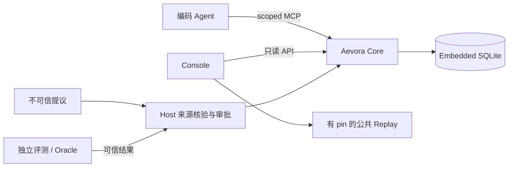

# 架构

原生 Go Host、领域服务、SQLite 与内置Console见 [运行时](RUNTIME.md)。
Python Core保留为历史对照与开发参考；Go/SQLite按业务、平台与恢复分别验收。
当前迁移参考保留生命周期读末尾的head复查、发布重放撤回保护，以及Console的
资源分页、Run过滤与请求总预算。新存储必须保留这些行为，不能从旧读快照或缓存
重新引入已观察到的撤回竞态。开发分支按职责叠放，综合验收通过后集中合入main。

Aevora 将经验适用性、证据解释、候选治理与接入权限放在明确边界内。
诊断来源与提炼模板分别固定身份；新来源按会话/回合分组，历史来源维持原始归属。
CLI 与 Console 复用领域层的有界来源分页，不读取原始工具输出。采集状态和可逆隔离
仅负责交付与恢复，不建立可信结果；具体边界见 [Codex 采集](CODEX_CAPTURE.md)。
原生产品以SQLite保存相同逻辑图；普通用户安装一个二进制。Python/FalkorDB
对照包仍可独立安装，用于旧来源复现和逻辑导出。

## 模块

| 模块 | 主要位置 | 职责 |
|---|---|---|
| 原生领域 | `go-runtime/internal/domain/` | WHEN/WHY、固定记录与关系、快照、候选治理、来源核验和观察反馈 |
| 原生存储 | `go-runtime/internal/storage/` | 固定SQL、事务、WAL、外键、OS文件锁、schema/DDL与一致性备份 |
| 原生Host/CLI | `go-runtime/internal/host/`、`cli/`、`native/` | scoped MCP、独立可信管理、多个Run、操作身份与用户入口 |
| 原生Console/交付 | `go-runtime/internal/observatory/`、`.goreleaser.yaml` | 内置公共静态资源、只读分页API、有pin回放和多目标包 |
| Core | `aevora_core/src/aevora/` | WHEN/WHY、记录校验、查询快照、候选生命周期、CLI/MCP |
| 图基础设施 | `graph_repository.py`、`checkpoint.py` | SDK、约束、参数化 Cypher、追加写入与恢复 |
| Host 启动 | `host_config.py`、`local_session.py`、`startup.py` | 受保护配置、内核会话锁、独占会话目录和可操作错误 |
| Console | `console/src/`、`console/web/` | 有限公共投影、API 与界面；不维护另一套治理引擎 |
| 演示 | `demo/` | 有 pin 的公共回放、独立 verifier、只读 walkthrough 与上下文示例 |
| 部署 | `deploy/` | FalkorDB Compose 与应用 Dockerfile；秘密和 volume 由 Host 管理 |
| 私有实验 | `app/`、`benchmark/`、`evaluator/` | 业务事故、提交保真和独立 Oracle；不随公开产品安装 |
| 运行与审计 | `integrations/`、`aevora_maintainer/` | 原生执行、受限模型通道、取消与私有证据 |
| 开发与交付 | `tools/` | 当前命令、源码清单和公开构建 |
| 维护者工具 | `aevora_maintainer/evidence/`、`validation/`、`runtime/` | 证据处理、完整回归、显式运行与收集 |

## 经验与结果

规则沿 `Experience → Revision → Rule → Premise` 解释适用条件；支持沿
`Evidence → VerifiedOutcome → Context → Task` 说明独立结果的事实环境。
完整前提和相关支持可产生 APPLY；事实冲突或相关反例导致 ABSTAIN；
未知事实或证据不足保持 VERIFY。策略名称和任务 ID 不能替代图中的证据链。

Agent 的 Query/Decision/Proposal、外部自测、可信 Outcome 和因果收益是
不同事实。候选经 Host 来源核验和有界 review 才能发布；记录真实结果不
自动证明采用经验或因果改善。初始化的空图和零候选有效。

### 任务相关召回与目标事实

原生 `resolve_experience`先用公开 `query`进行 FTS5/BM25 词法召回，再对所选经验
执行原有 WHEN/WHY 和发布 head 复查。任务文本只具有相关性权重，不能建立或覆盖
可信条件。缺少任务描述时返回 `TASK_QUERY_REQUIRED`和空候选；不会仅因 Host 条件
相同而推荐经验。可信维护者的内部条件诊断保留既有语义及读取预算。

索引只包含 Experience/Candidate 的标题、公共摘要和策略。它在专用 SQLite 连接的
TEMP 表中按需重建，事务内触发器随源记录提交/回滚；不改变 graph DDL、持久格式、
备份或原始证据。候选选择从索引获得，证据读取仍验证来源和当前生命周期。中文
使用字符片段，受控工程别名要求识别出的概念共同匹配；不是通用语义或翻译服务。

可选受保护回环嵌入器在事务外读取公开叙述，按余弦阈值与词法结果做 RRF 融合。
故障明确降级，缓存不赋权；发布状态与 WHEN/WHY 在事务内重新检查。
配置、容量、缓存与真实质量的边界见[任务检索](RETRIEVAL.md)。

默认返回最多 5 条、总量有界的摘要卡片，完整证据经实际 Query 身份按需展开。
预算省略的经验不获得该 Query 的关联权限；查询快照保留完整证据和历史语义。
`search_observations(mode="ranked")`复用词法索引，始终是未核验线索。

本地任务和自动 enrollment 从受保护项目注册收集 `target_project`，并只读观察
工作区 Git HEAD/分支为 `target_revision`/`target_branch`。这些事实与 Host 的
`runtime_*`分开。Git 不可用、没有提交或 detached branch 时相应字段保持未知；
可选的工作目录路由只将 connector 当前目录作为选择提示，Host 检查同一后端的明确
授权项目及其固定注册工作区，并独立测量；一个连接在重连时保留原项目和 Run。
未注册目录仅使用 Host 运行时事实，不继承配置或默认项目的 `target_*`；历史任务
的目录选择状态在恢复和关闭时核对，不能借降级模式重新绑定。
不运行仓库脚本/钩子。事实固定在任务建立时，恢复时重新采集，不一致要求新任务。
有界 Git porcelain 状态、暂存区差异和变化文件元数据产生工作区状态与摘要；
已注册根目录和有界一级模块的固定依赖清单/锁文件产生汇总内容摘要，并只提取
go/node/python 的版本声明；不同模块声明不一致时单值字段保持未知，不挑一个代表全部。
这些声明不等于已安装版本，工作区元数据摘要也不是全部文件的内容证明。
新观察任务的每次经验查询在检索前后检查变化；不一致返回 RUN_CONTEXT_CONFLICT，
需要新任务，原 Query 和已提交操作回放保留。它不测量模型覆盖参数或实际结果。

### 自动学习与策略授权

原生 Host 可消费经 [Codex hook 适配器](CODEX_CAPTURE.md)提取的闭集诊断信号。
采集 outbox 与图内提交以内容身份和确认摘要衔接；事件属于未核验外部声明，
不得替代独立来源或 Outcome。运行 drainer 不证明 Codex hook 已启用或受信任。

日常观察、事实记忆和待验证策略应能自动积累，并按项目隔离、检索、整理与失效。
记忆的保存不要求逐条人工审核；未核验内容保留其来源和限制，作为调查线索使用。
经验的自动核验、准入和发布由预先授权的可信作业执行。独立来源是权限与证据边界，
不等于每条记忆必须由人批准；固定验证器、机器 receipt 和有界策略可以承担检查。

自动化至少区分三层：观察自动保存；受保护验证作业在配置范围内自动晋升；
超出范围、出现冲突或无法建立关键条件时保留待处理状态。人工介入处理例外和策略
调整，不作为每条观察的默认处理步骤。候选 Agent 不能修改验证器或晋升策略。

衡量能力增长时，分别记录有用线索召回、跨任务实际复用、错误经验的抑制与修复
时间/工具成本。累积条数和调用次数不是目标；自测、核验和受控对照各自证明不同结果。

Console 默认 LIVE 按当前 graph/Run 组织。项目连接、数据进度和经验适用性
分别表达；经验可用性复用 Core 发布门禁，推荐来自实际 Query 关联的不可变
快照，HTTP 不生成新查询。历史 Case 与演示上下文只属于显式 REPLAY。

## 信任与写入

Host 持 DB/模型秘密，Agent 仅获可撤销 scoped 能力。公开包不携带私有
Oracle、隐藏测试、参考修复和维护者身份。OrderFlow 是一个独立可信结果
来源；`orderflow_outcome_bridge` 是显式 Host adapter，私有导入延迟到验证操作。
普通项目通过 `project_source` / `source-project` 导入由 Host 独立授权的验证器
receipt、固定测试集/runner、提交和 JUnit；公共包不执行产物中的代码。
`source_evidence` 共享有界文件读取与 JUnit 校验，`project_receipt` 只打包，
不赋予信任。`independent_project` 与原生 Agent、合成 fixture 分别保留来源；
准入、发布和 UNKNOWN 语义复用现有 Core。契约见[公开集成指南](PROJECT_SOURCES.md)。

原生可信CLI加载v2 profile，数据库与Go领域共用Host内的受控事务池；HTTP只读。
v1 profile显式保留Python Worker/FalkorDB对照，不作为普通用户前提。
connector 只读取稳定会话根的 selector 与当前 scoped grant，不读取 Host profile；
配置不授予 consumer DB 能力。每次启动创建独立目录、manifest 和事件，正常退出
撤销 grant/socket；可变 `current.json` 不属于证据。Console 动态选择当前日志，
原始会话事件不改写。具体优先级与恢复边界见[MCP](MCP.md#host-配置与会话恢复)。

图记录使用稳定身份、canonical payload 和摘要，冲突拒绝覆盖。候选 head
转移有实际CAS fence；Go业务写入与operation结果在同一SQLite事务提交，响应送达
单独记录，UNKNOWN不自动重放。只读多查询不声明全局快照，最终可变head另行读取。
Python/FalkorDB对照的多语句追加仍保留完成记录和显式恢复。版本和字段参考
[Schema](../aevora_core/docs/GRAPH_SCHEMA.md)及[查询参考](../aevora_core/docs/QUERY_COOKBOOK.md)。

公共 verifier/projection 只在 `tools/public_evidence/` 编辑，四份独立分发
副本确定性生成；静态 UI 有构建 manifest。独立安装、公开 allowlist、
本地编辑器配置和物理执行隔离是不同边界。

运行与产品限制见[LIMITATIONS](LIMITATIONS.md)，开发与维护见根 DEVELOPMENT。

## 工程任务记忆

[任务记忆](TASK_MEMORY.md) 在既有 ExternalObservation 与 AuditEvent 中保留版本化来源和
追加作业账本，不改变图 DDL。官方 app-server 的完成项经工作区路由后进入持久 outbox，
跨回合关联依然是低信任观察。整理结果、来源关系与处理完成同事务；占用 fence、重试预算
和快照摘要用于恢复。来源 ID 界面分页与后台处理进度分别实现。

内置 JSON 工件检查器只运行固定契约、不执行提交代码；它在写事务外产生独立工件和回执，
随后复用 VerifyProjectCandidate / AutomateCandidate。来源事实与晋升范围必须限定 JSON
契约操作，不能扩为所有工程任务。撤销来源传播到依赖候选；已核验工件/策略变化撤回当前
支持，历史查询保留。更多模型提炼、技能学习和收益对照仍需单独开发与验证。

## 维护与兼容

当前入口直接使用按职责组织的模块。一次性阶段流程原件保存在外置离线备份；
`aevora_maintainer/compatibility/` 解释既有 Gate、Audit-Lite 和演示记录格式，
其中的格式标识保留原义，不参与普通 Core/Console 接入。测试按 unit、
integration、contracts、compatibility 组织，路径迁移见 tests/IDENTITIES.json。
