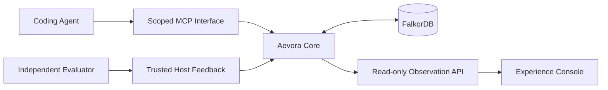

# Aevora — Architecture Outline

This document summarizes the existing local design. This GitHub tree is a
documentation-only outline; interface names here do not mean an executable
implementation or new validation result is included.

## System boundaries



### Core and graph

Core owns applicability and evidence reasoning, candidate lifecycle and trusted
feedback admission. Graph access belongs behind one repository boundary and
uses the actual FalkorDB database. Missing premises remain unknown; a query or
successful task does not establish adoption or causal benefit.

The applicability vocabulary is APPLY / VERIFY / ABSTAIN. Evidence includes its
source and factual scope, support and counterexamples. Source and outcome
authority must remain distinguishable from untrusted Agent claims.

### Agent integration

The scoped MCP boundary presents experience retrieval, evidence inspection,
decision recording and opt-in candidate proposals. Existing design names are
`resolve_experience`, `build_evidence_bundle`, `record_decision` and
`propose_experience`. The Agent-facing interface does not grant arbitrary graph
administration, trusted Outcome creation or experience publication.

### Trusted feedback

An independent evaluator owns task scoring. A trusted Host checks the actual
submission and its evidence before accepting feedback and reviewing a candidate.
Agent self-tests, a recorded decision and a candidate proposal do not carry
independent verification authority. Publication is a separate Host decision.

### Console and demonstration

The observation API is read-only. The planned documentation layout follows the
existing Activity & Decisions, Experience Explorer and Governance Timeline
views. LIVE and historical REPLAY remain explicit modes; an unavailable live
database cannot silently become a successful replay response.

## Repository outline

```text
README.md
docs/ARCHITECTURE.md
aevora_core/README.md    # Core and MCP boundary placeholder
console/README.md        # Read-only observation boundary placeholder
h4/README.md             # Existing demo/onboarding asset boundary placeholder
```

Directory names retain the existing local architecture. These Markdown
placeholders do not introduce packages, executable APIs, database fixtures or
deployment services. Future implementation imports require their own scope and
verification.

## Product and Benchmark separation

OrderFlow Incident Lab remains a separate Benchmark. Hidden tests, private
manifests, reference fixes, raw model archives, maintainer history and credentials
are outside the product publication boundary. Public documentation must not be
used as proof that a live experiment or regression was newly executed.
