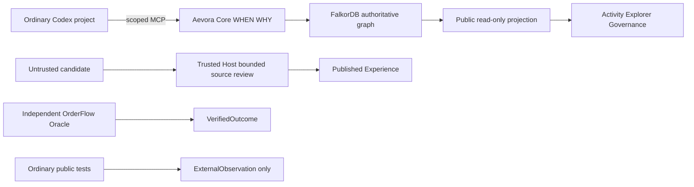

# Aevora: graph authority and public observation

Aevora Core uses actual FalkorDB SDK/Cypher. The Console displays existing Core results and bounded public graph fields. It is not a second decision engine. A fresh user volume has no imported historical experiences.



The public package includes the schema documentation in `aevora_core/docs/GRAPH_SCHEMA.md`. Immutable node payloads and relationship IDs remain subject to actual database constraints. H3's lifecycle extension has22 labels and44 mandatory/unique constraints. Host administrative writes are a separate authority. Multi-step checks and writes do not promise a global transaction.

Material path: Experience → HAS_REVISION → ExperienceRevision → USES_RULE → Rule → REQUIRES → Premise. Relevant support follows SUPPORTED_BY → Evidence → VERIFIES → VerifiedOutcome → IN_CONTEXT → Context → FOR_TASK → Task. Counterexample, governance and revision edges can limit applicability. Record Decision claims and external observations separately from verified outcomes.

Actual bounded public read queries:

```cypher
MATCH(n) RETURN count(n)
MATCH(n) RETURN labels(n),n.id,n.payload_json,n.payload_sha256 ORDER BY n.id LIMIT 501
MATCH(s)-[r]->(t) RETURN s.id,type(r),r.id,r.payload_sha256,t.id ORDER BY s.id,r.id LIMIT 1201
```

The payload read is trusted-host only: the HTTP response uses explicit label-specific public field allowlists. Browsers cannot execute Cypher. Depth3/64 API focus and24-node initial display are declared presentation limits; missing graph relationships stay missing. LIVE uses `ExperienceResolver.resolve(..., persist_snapshots=False)` and performs no Decision/Outcome/Review writes. Cross-query reads are not an atomic graph snapshot.

The actual Case C source intervention and readback are in the independently pinned public `h4/replay/evolution.json` and `queries.json`. Deleting the recorded VERIFIES relationship changed support1→0/APPLY→VERIFY; restoration returned APPLY; old QuerySnapshot fingerprints remained unchanged. This was a maintained replica experiment, not Agent feedback or causal improvement. The portable verifier checks exact endpoints, relation, result and query references.

MCP tools: resolve_experience, build_evidence_bundle, record_decision and opt-in propose_experience. Last two are untrusted writes. Source verification, Host approval, publishing and VerifiedOutcome creation are not exposed to Agents or Viewer HTTP.
