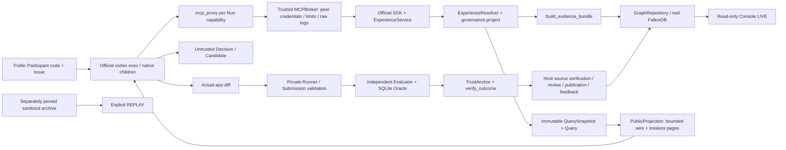

**Freeze candidate:** `aevora.gen2.contract/2.0.0-rc1`. **Status: PROPOSED / NOT_IMPLEMENTED**, except individually identified AS-IS source and TESTED design probes. This directory is MAINTAINER_DESIGN_REVIEW, not Participant input or an automatically approved public export. G20 does not authorize G2-1.

# G20-B — 源码 AS-IS 审计

## 实际调用与可信边界（IMPLEMENTED；本次 STATIC_AUDIT）

## 已实现，不重建

| 源码与符号 | 实际语义 / 原证据入口 |
|---|---|
| graph_repository.py::initialize/put_node/put_edge | 真实 FalkorDB；异步 UNIQUE/MANDATORY 等待 OPERATIONAL；payload SHA/同ID冲突拒绝；多条 query 并非全局事务 |
| experience_resolver.py::ExperienceResolver.resolve/_resolve_one | 枚举最多256经验；基于实际多跳支持/反例、必要前提、作用域、治理与时间给三态；QuerySnapshot 精确回放；无 Episode 分支 |
| evidence_bundle.py::build_evidence_bundle | Rule→Premise、Revision→Evidence→VerifiedOutcome→Context→Task；allowlist；分开 support/counter/observed |
| governance.py::project | 显式 SUPERSEDES、作用域、validity、withdraw/expire/restrict；冲突保守 VERIFY；不存在已证因果分数 |
| candidate.py::CandidateLifecycle | PROPOSED→EVIDENCE_PENDING→ADMITTED_BOUNDED→PUBLISHING→PUBLISHED 等；原子单 query head fence；构建阶段可重试、发布前不可见 |
| admission.py::verify_orderflow_candidate | 同 Run、已封存 typed 原生提案+MCP request/reply+Patch+独立 Outcome；语义审批独立于来源校验 |
| feedback.py::ingest_outcome | 真 Outcome、实际 Query/Decision 边与快照；OBSERVED_OUTCOME 不等于 SUPPORTED_BY，不推断采用/因果 |
| mcp_server.py::ExperienceService / create_server | VERSION aevora.mcp/1.2；三基础工具加 opt-in propose；Host facts 与 Participant claims 分离；agent_thread_id 仍 UNAVAILABLE |
| mcp_projection.py::PublicProjection | WIRE196608 / broker262144；RFC6901；HMAC connection/run/document scope；900s 不延长游标；缓存32文档/16MiB、detail8MiB |
| integrations/codex_agent.py / gateway_broker.py | 官方CLI、真实 Gateway、completion-aware None 总时限/请求限额、独立 Runtime/Evaluation/Integration；原生协调由 Codex 拥有 |
| integrations/native_rollout_trace.py::analyze_native_rollouts | pinned rust-v0.162.1；子自身 session_meta/parent/session + 新 turn、任务交付、执行、final/task_complete/父回执；不从正文造 Agent |
| benchmark/submission.py + evaluator/runner.py | 提交保真、隔离候选、完整必要测试身份、JUnit/退出码；宿主直接审 SQLite；独立于公开 Core |
| orderflow_outcome_bridge.py::TrustAnchor/verify_outcome | 只读授权归档、fd/no-follow、源/报告/补丁/JUnit/Oracle pin；ordinary observation 默认 EXTERNAL_UNVERIFIED |
| console/src/.../server.py::create_app | loopback + read-only API，8资源；LIVE/REPLAY 区分，断库不 fallback；三页已有 |
| tools/dev.py / public_release.py::chosen/build | 一个成熟命令入口；显式 public allowlist；Core/Console 无需 Benchmark 安装；工作区不是沙箱 |

具体行号/字节 SHA 与原测试归属由 SOURCE_ENTRYPOINT_MAP.csv、SYMBOL_AND_IMPORT_INDEX.json 固定，避免文档行号漂移。

## 实际缺口，不能把规划当成已有产品

1. 模型已有 Agent/Decision/ObservedAction 标签，**没有完整 Session/Run/Recommendation/DeliveryReceipt 的正式图合同**。MCP connection/peer PID 不是 native child identity。CONSIDERED 是完整 resolver 候选，不证明某页被交付。
2. 主查询仍从 experience_ids 枚举，在 Python 内做规则/治理比较；多数业务属性位于 payload_json，缺少受控原生索引投影与一体化、带成本上界的 v2 witness 查询。
3. 没有部署级 tenant selector/tenant-wide epoch/授权代次合同；单个图名称和 run token 并不自动形成完整多租户产品。旧 snapshot replay 不保证语义撤回后不可读取历史；Gen2 明确区分当前推荐权限与历史阅读权限。
4. 既有 Context 是可信平面 facts。当前环境、修复后工件属性与验证后置条件缺少正式 phase。V5C.1 Core VERIFY / Agent APPLY 的差异保留；不能重标旧事实来改善历史成绩。
5. 宿主来源验证保留旧 source_epoch 字符标签，实际源字节另 pin；Gen2 事件应使用真实 build/contract/source digest，旧 label 只作 legacy provenance。
6. Console LIVE 仍有 H4 case-a/b/c 和演示默认经验 selector；这属于已有展示契约，不能当作通用图裁决逻辑。Gen2 增量替换为有来源的 Recommendation/Run 查询，保留旧 Replay。
7. 有界 wire 已解决事故，但图遍历/中间结果/查询数尚需完整预算及 overflow 不产生肯定裁决的合同。Graph admin/共享内核攻击不在已证明隔离范围。

本轮未重跑1897，也未新验证 native协作或 Host在线闭环；历史 evidence 与今天的 STATIC_AUDIT 分列。
