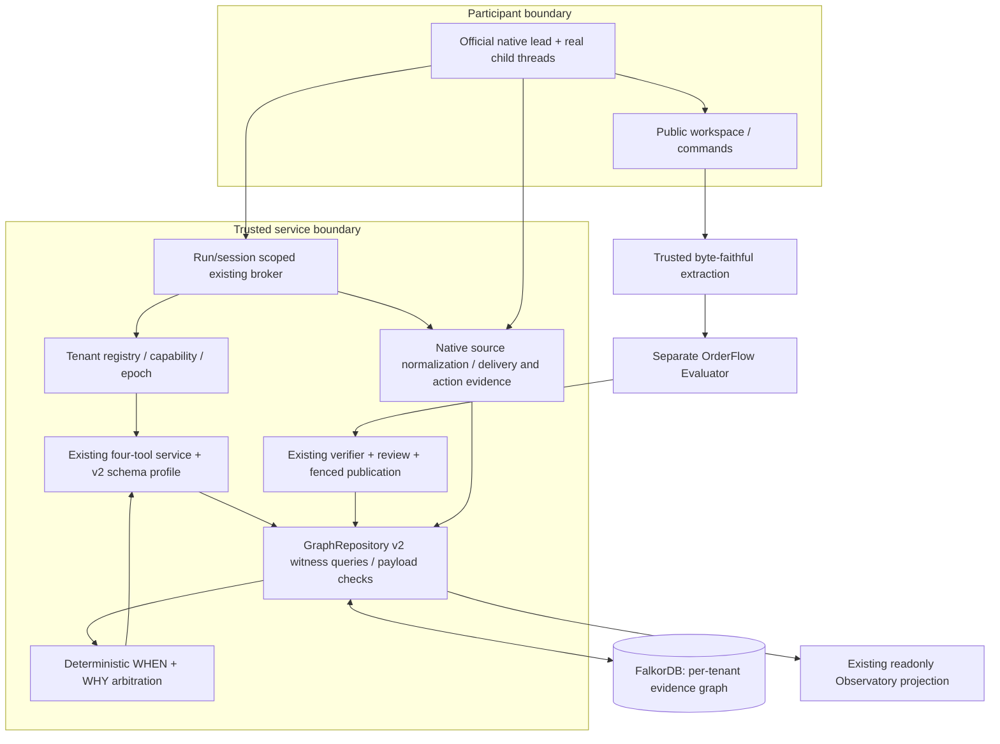

**Freeze candidate:** `aevora.gen2.contract/2.0.0-rc1`. **Status: PROPOSED / NOT_IMPLEMENTED**, except individually identified AS-IS source and TESTED design probes. This directory is MAINTAINER_DESIGN_REVIEW, not Participant input or an automatically approved public export. G20 does not authorize G2-1.

# G20-C — 最终产品架构

## 产品承诺与复用

Aevora 对**有明确范围的策略经验**提供 WHEN/WHY、可信观察反馈和可核查传递链；不替 Agent 写补丁、不替独立 Oracle 判分、不以经验命中率保证解题。Gen2 完整实现全部闭环，不将冲突治理、Host、真实多 Agent、ordinary项目接入或发布推到假设的 Gen3。

## 模块责任与冻结接口

| 责任 / 拟扩展源码 | 输入→输出及持久化 | 幂等 / 失败 / 权限 |
|---|---|---|
| TenantBinding（新 contracts.py + 原 broker/connect） | OS-authenticated registry capability→tenant graph/profile/run/session；不接受工具传 tenant/graph | capability_id+authz_epoch；撤销立即拒绝；无 Caller Host角色 |
| Graph witness（原 graph_repository.py / 新 graph_queries.py） | AuthorizedContext+read_epoch→完整 bounded premises/support/counter/governance witnesses+hash | 所有读取绑定tenant、generation、epoch；超限/断库显式错误；无备用静态库 |
| WHEN（原 experience_resolver.py 增量） | 可信 task facts+necessary/hard exclusions→三态；Agent claims 仅审计 | query/request_key+context digest；未知永不升格已知；严格 bool≠int |
| WHY（原 evidence_bundle/governance + 新 arbitration.py） | 实际 paths、scope、authority、validity、revision→Recommendation + reasons/conflicts/witnesses | policy/graph/context hashes；没有全局成功分数；缺边或不完整不 APPLY |
| Host（原 admission/candidate/feedback） | Pin完整独立 outcome/source→review/commit/restrict/withdraw | manifest+candidate+expected_head/epoch；单query最终fence；准备失败不可见，保留失败，可重试 |
| Accountability（原 trace + 新 integration归一化） | 原始 typed Native/MCP/Patch/Oracle→分级 ToolEvent/DeliveryReceipt/Action links | source file+line hash；重复稳定ID；身份不能观测为 UNAVAILABLE；不从文本推断父子 |
| Runtime（原 CodexAgentAdapter） | Public Task→真实 official session/children→Patch | 全新session；completion-aware；None总预算；资源、重试、cancel；三层结果独立 |
| Product（原 Console/projection） | Authorized public graph/receipt→三页 bounded readonly view | LIVE从数据库；REPLAY单独pin；失联清空LIVE，无旧数据回退；不增加Host写权限 |

所有“新”模块在本轮 **PROPOSED**；不新建 Router、Planner/Coder Python orchestration、第二套 DB 或测试框架。Core 无 OrderFlow 导入依赖；OrderFlow bridge 以现有延迟、授权 adapter 接入。

## WHEN / WHY 的确定性优先级

1. 授权失败、断库、损坏、查询/文档超限：**ERROR，不生成看似完整推荐**。规则声明缺失/快照混读可恢复则最多 VERIFY，必须 integrity=INCOMPLETE；不能输出 APPLY。
2. Host明确撤回/过期/必要前提违反/已知硬排除：ABSTAIN。完整性不足时不伪造违反理由；输出VERIFY或显式错误，保留独立可证明的硬排除。
3. 同一适用域有完整权威支持和权威业务反证：VERIFY，枚举所有冲突 witness，标 REQUIRE_HOST_REVIEW；两经验不同scope可并存，不合并。
4. 匹配权威业务反证、无矛盾正控：ABSTAIN；基础设施 ERROR/TIMEOUT 不是策略反证。授权真实性不等于因果归属，反证必须有策略/工件/适用域关联证明。
5. 必要或 material task 前提 UNKNOWN/MISSING/NOT_OBSERVED、潜在反证、并行未决修订：VERIFY并列独立核验步骤。
6. 只有全部必要task前提已知匹配、无硬否决、完整当前域支持、无未解反证/修订冲突才APPLY，含义是有界推荐原则，**不是当前补丁已正确**。

取消任何“分数足够高覆盖前提不符”的设计。候选稳定ID排序只为分页，不是策略优先级；多个合法APPLY保留，由Agent选取并解释。Core verdict、Agent claim、Host outcome永不覆盖彼此。

## Fact phase（新增必需机制）

Context保留 `task`（环境/语义/目标）、`artifact_before`、`artifact_after`、`evaluation` 四 phase。事实必须有 authority、availability、source digest、observed_at。WHEN仅比较 rule 声明的**task必要前提**；修复后属性为独立验证的 evidence/postcondition，不偷换成目标已经具备的条件。若经验必须依赖初始实现属性，明确 rule 使用 artifact_before，并要求当前同phase已知。Agent观察不能自行变Host pin。

旧平面 Context 在兼容 profile 下保持原语义/UNKNOWN；**不自动重分类历史authority_validation**。新的phase化事实只有新Host注册/验证流程可以产生，需单独正反测试。此机制使修复原则可迁移而不要求目标已修好，但不规避必要前提缺失。

## 一致性与故障语义

每租户一物理图，TenantState 包含 schema/policy/generation/epoch/authz_epoch。准备的不可变记录和manifest不激活；最终 publication/governance fence 在**一条写query**关联 COMMITS、更新必要head与epoch。普通审计telemetry不提升证据epoch。查询开始/结束读epoch一致方可签发Recommendation；变化最多重新获取一次，持续竞争 GRAPH_CHANGED，不能混合结果。此协议依赖所有可信写者遵守fence；恶意DB管理员不在保证内。

缓存只保留授权的投影快照，绝不成为决策真值。每页检查当前capability/authz_epoch/graph epoch/lifecycle；撤销或语义变化返回STALE_SNAPSHOT，普通会话不得继续读旧推荐。合法历史审计需单独read_history grant、显式REPLAY及原epoch显示。

## 可证伪产品验收

缺支持边→不再APPLY；完整复原→相同context/policy恢复原裁决；同域权威反证→VERIFY/ABSTAIN；异域成功不覆盖；撤销后旧cursor拒绝；断库无结果fallback；原生两个不同child自身活动/回传可核；newID完整Bundle+Decision+action+独立Outcome关联可审。真实成绩失败照录。容量/时延合同见Graph与Gate计划，不以测试数替代这些属性。
